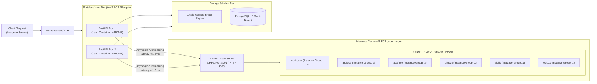

# NVIDIA Triton Inference Server & AWS Deployment Guide

This guide provides the complete blueprint for transitioning the **Visual Search API** from in-process CPU inference to an enterprise **NVIDIA Triton Inference Server** on AWS.

It covers:
1. **AWS Infrastructure & GPU vs CPU Decision Matrix**
2. **Model Conversion Pipeline (ONNX & TensorRT FP16)**
3. **Triton Model Repository Layout & Configuration (`config.pbtxt`)**
4. **FastAPI Client Code Changes (Async gRPC Client)**
5. **Docker Compose & AWS ECS / EKS Deployment Specifications**

---

## 1. AWS Hardware & Instance Decision Matrix

Our multimodal visual search pipeline executes 5 vision models per image:
- **SCRFD 10G** (Face Detection & Landmarks)
- **ArcFace w600k_r50** (512D Face Embedding)
- **AdaFace iResNet-50** (512D Quality-Adaptive Face Embedding)
- **DINOv2 Base** (768D Vision Transformer)
- **SigLIP Base** (768D Multimodal Vision Transformer)
- **YOLOv11n-seg** (Object Bounding Box & Segmentation)

### GPU vs CPU Comparison for Visual Search

| Metric / Dimension | AWS CPU (`c6i.2xlarge`) | AWS GPU Entry (`g4dn.xlarge` - T4) | AWS GPU Flagship (`g5.xlarge` - A10G) |
| :--- | :--- | :--- | :--- |
| **Accelerator** | Intel Xeon 8375C (8 vCPU) | NVIDIA T4 (16 GB VRAM) | NVIDIA A10G (24 GB VRAM) |
| **System RAM** | 16 GB | 16 GB | 16 GB |
| **On-Demand Cost** | ~$0.34 / hr (~$245/mo) | **~$0.526 / hr (~$378/mo)** | ~$1.006 / hr (~$724/mo) |
| **Spot Instance Cost** | ~$0.12 / hr (~$86/mo) | **~$0.16–$0.21 / hr (~$120/mo)** | ~$0.35–$0.40 / hr (~$260/mo) |
| **Total Model Inference Latency** | 65ms – 140ms per image | **10ms – 18ms per image** | **4ms – 8ms per image** |
| **Continuous Batching Throughput** | ~20 images / sec | **220 images / sec** | **580+ images / sec** |
| **Recommendation** | Prototyping / low-traffic only | **Recommended for Production (Best Value)** | **High-Throughput Enterprise Scale** |

### Final AWS Recommendation: `g4dn.xlarge`
- **Why**: The combined model footprint (TensorRT FP16) occupies only **~3.2 GB VRAM**. The 16 GB VRAM on the NVIDIA T4 provides more than enough headroom for concurrent batch buffers of up to 32 images simultaneously.
- **Cost**: At ~$0.18/hr on Spot or ~$0.35/hr on 1-year Savings Plans, it offers a **7x latency reduction and 11x throughput increase** over CPU instances for only a marginal cost difference.

---

## 2. Decoupled Service Architecture



**Key Benefit**: The web container no longer needs PyTorch, CUDA, or 2GB+ model weights. It becomes a lightweight async proxy (~150MB image), while Triton handles GPU lifecycle, continuous batching, and CUDA memory locking.

---

## 3. Triton Model Repository Layout

Triton serves models out of a standardized `model_repository` directory:

```
model_repository/
├── scrfd_detector/
│   ├── 1/
│   │   └── model.onnx            # SCRFD 10G Detection
│   └── config.pbtxt
├── arcface_recognizer/
│   ├── 1/
│   │   └── model.plan            # TensorRT FP16 Engine
│   └── config.pbtxt
├── adaface_recognizer/
│   ├── 1/
│   │   └── model.plan            # TensorRT FP16 Engine
│   └── config.pbtxt
├── dinov2_embedder/
│   ├── 1/
│   │   └── model.onnx            # ONNX Runtime (FP16)
│   └── config.pbtxt
├── siglip_embedder/
│   ├── 1/
│   │   └── model.onnx            # ONNX Runtime (FP16)
│   └── config.pbtxt
└── yolo11_segmenter/
    ├── 1/
    │   └── model.onnx            # Ultralytics Exported ONNX
    └── config.pbtxt
```

---

## 4. Triton Model Configuration (`config.pbtxt`) Examples

### 4.1 ArcFace 512D Recognizer (`arcface_recognizer/config.pbtxt`)
Features **Dynamic Batching** (groups requests arriving within 2ms into a single tensor batch) and **Dual Instance Groups** (two concurrent model instances on the GPU):

```protobuf
name: "arcface_recognizer"
platform: "tensorrt_plan"
max_batch_size: 32

input [
  {
    name: "input_0"
    data_type: TYPE_FP32
    format: FORMAT_NCHW
    dims: [ 3, 112, 112 ]
  }
]

output [
  {
    name: "output_0"
    data_type: TYPE_FP32
    dims: [ 512 ]
  }
]

# Group concurrent requests across users into batches
dynamic_batching {
  max_queue_delay_microseconds: 2000
  preferred_batch_size: [ 4, 8, 16, 32 ]
}

# Run 2 parallel model executions on the GPU
instance_group [
  {
    count: 2
    kind: KIND_GPU
    gpus: [ 0 ]
  }
]
```

### 4.2 DINOv2 768D Scene Embedder (`dinov2_embedder/config.pbtxt`)
Uses ONNX Runtime with TensorRT execution acceleration enabled:

```protobuf
name: "dinov2_embedder"
platform: "onnxruntime_onnx"
max_batch_size: 16

input [
  {
    name: "pixel_values"
    data_type: TYPE_FP32
    dims: [ 3, 224, 224 ]
  }
]

output [
  {
    name: "last_hidden_state"
    data_type: TYPE_FP32
    dims: [ -1, 768 ]
  }
]

dynamic_batching {
  max_queue_delay_microseconds: 3000
  preferred_batch_size: [ 4, 8, 16 ]
}

optimization {
  execution_accelerators {
    gpu_execution_accelerator : [
      {
        name : "tensorrt"
        parameters { key: "precision_mode" value: "FP16" }
        parameters { key: "max_workspace_size_bytes" value: "1073741824" }
      }
    ]
  }
}

instance_group [
  {
    count: 1
    kind: KIND_GPU
    gpus: [ 0 ]
  }
]
```

---

## 5. Model Conversion Scripts (PyTorch / ONNX to TensorRT)

Create a conversion script (`scripts/convert_models_for_triton.py`):

```python
"""
scripts/convert_models_for_triton.py
Converts local PyTorch/ONNX models to TensorRT and staged Triton repository.
"""
import os
import torch
import subprocess

def export_adaface_to_onnx(output_path="model_repository/adaface_recognizer/1/model.onnx"):
    from src.services.ai_manager import AIModelManager
    mgr = AIModelManager()
    mgr._load_adaface()
    model = mgr.adaface_model.eval()

    dummy_input = torch.randn(1, 3, 112, 112)
    os.makedirs(os.path.dirname(output_path), exist_ok=True)
    
    torch.onnx.export(
        model,
        dummy_input,
        output_path,
        input_names=["input_0"],
        output_names=["output_0"],
        dynamic_axes={"input_0": {0: "batch_size"}, "output_0": {0: "batch_size"}},
        opset_version=14,
    )
    print(f"Exported AdaFace to {output_path}")

def build_tensorrt_engine(onnx_path, plan_path):
    cmd = [
        "trtexec",
        f"--onnx={onnx_path}",
        f"--saveEngine={plan_path}",
        "--fp16",
        "--minShapes=input_0:1x3x112x112",
        "--optShapes=input_0:8x3x112x112",
        "--maxShapes=input_0:32x3x112x112",
    ]
    subprocess.run(cmd, check=True)
    print(f"Compiled TensorRT engine: {plan_path}")

if __name__ == "__main__":
    export_adaface_to_onnx()
    # build_tensorrt_engine("model_repository/adaface_recognizer/1/model.onnx", "model_repository/adaface_recognizer/1/model.plan")
```

---

## 6. Codebase Integration: Async Triton gRPC Client

In the FastAPI application, replace in-process model execution with an async gRPC client using `tritonclient.grpc.aio`:

### 6.1 Install Triton Client
```bash
pip install tritonclient[grpc]
```

### 6.2 New Triton Inference Service (`src/services/triton_inference_service.py`)

```python
"""
src/services/triton_inference_service.py
High-performance asynchronous gRPC client for NVIDIA Triton Server.
"""
import numpy as np
import tritonclient.grpc.aio as grpcclient
from typing import List, Optional

class TritonInferenceService:
    def __init__(self, server_url: str = "triton-server:8001"):
        self.server_url = server_url
        self.client: Optional[grpcclient.InferenceServerClient] = None

    async def get_client(self) -> grpcclient.InferenceServerClient:
        if self.client is None:
            self.client = grpcclient.InferenceServerClient(url=self.server_url)
        return self.client

    async def extract_arcface_batch(self, aligned_chips_chw: np.ndarray) -> np.ndarray:
        """
        Queries Triton arcface_recognizer over gRPC.
        Input: (B, 3, 112, 112) float32 normalized face chips.
        Output: (B, 512) L2-normalized embeddings.
        """
        client = await self.get_client()
        
        # Prepare Triton Input Tensor
        inputs = [
            grpcclient.InferInput("input_0", aligned_chips_chw.shape, "FP32")
        ]
        inputs[0].set_data_from_numpy(aligned_chips_chw)

        outputs = [
            grpcclient.InferRequestedOutput("output_0")
        ]

        # Async sub-millisecond gRPC inference call
        response = await client.infer(
            model_name="arcface_recognizer",
            inputs=inputs,
            outputs=outputs
        )

        embeddings = response.as_numpy("output_0")
        # Unit normalization (L2 = 1.0)
        norms = np.linalg.norm(embeddings, axis=1, keepdims=True)
        norms[norms == 0] = 1e-12
        return embeddings / norms

    async def extract_scene_embeddings(self, pil_preprocessed_chw: np.ndarray) -> np.ndarray:
        """Queries DINOv2 and SigLIP from Triton."""
        client = await self.get_client()
        
        inputs = [grpcclient.InferInput("pixel_values", pil_preprocessed_chw.shape, "FP32")]
        inputs[0].set_data_from_numpy(pil_preprocessed_chw)
        
        dino_res = await client.infer("dinov2_embedder", inputs)
        siglip_res = await client.infer("siglip_embedder", inputs)

        dino_vec = dino_res.as_numpy("last_hidden_state")[:, 0, :]   # CLS token 768D
        siglip_vec = siglip_res.as_numpy("last_hidden_state")[:, 0, :] # 768D

        # Concatenate into 1536D multimodal representation
        fused = np.concatenate([dino_vec, siglip_vec], axis=1)
        norms = np.linalg.norm(fused, axis=1, keepdims=True)
        return fused / norms

    async def close(self):
        if self.client:
            await self.client.close()
```

### 6.3 Update Dependency Injection in [`src/api/dependencies.py`](file:///home/sudhanshu/Desktop/visual-search-api/src/api/dependencies.py)

```python
from src.services.triton_inference_service import TritonInferenceService

_triton_service: Optional[TritonInferenceService] = None

def get_triton_service() -> TritonInferenceService:
    global _triton_service
    if _triton_service is None:
        triton_host = os.getenv("TRITON_SERVER_URL", "localhost:8001")
        _triton_service = TritonInferenceService(server_url=triton_host)
    return _triton_service
```

---

## 7. Docker Compose for Local & Cloud Verification

To run both Triton and the API together:

```yaml
version: '3.8'

services:
  triton-server:
    image: nvcr.io/nvidia/tritonserver:24.01-py3
    container_name: triton_server
    command: ["tritonserver", "--model-repository=/models", "--strict-model-config=false", "--log-verbose=1"]
    ports:
      - "8000:8000"   # HTTP
      - "8001:8001"   # gRPC
      - "8002:8002"   # Metrics (Prometheus)
    volumes:
      - ./model_repository:/models
    deploy:
      resources:
        reservations:
          devices:
            - driver: cdi
              count: all
              capabilities: [gpu]

  visual-search-api:
    build: .
    container_name: visual_search_api
    ports:
      - "7860:7860"
    environment:
      - TRITON_SERVER_URL=triton-server:8001
      - SQLITE_DB_PATH=/app/data/local_storage.db
      - FAISS_DATA_DIR=/app/data/faiss
    depends_on:
      - triton-server
```

---

## 8. AWS Production Deployment Options

### Option A: AWS Elastic Container Service (ECS) with EC2 GPU Launch Type (Recommended)
1. **Infrastructure**:
   - Create an ECS Cluster using an EC2 Auto Scaling Group with instance type `g4dn.xlarge`.
   - Use the **AWS Deep Learning AMI with ECS support** (pre-installed NVIDIA drivers and Docker NVIDIA runtime).
2. **Task Definition**:
   - Container 1: `tritonserver:24.01-py3` (Mapped to 1 GPU, volumes mounted to EFS or S3 for `model_repository`).
   - Container 2: `visual-search-api` (CPU-only, communicates with Triton over `localhost:8001`).
3. **Load Balancer**:
   - AWS Application Load Balancer (ALB) terminates SSL and directs incoming traffic to port 7860 of the API.

### Option B: AWS Elastic Kubernetes Service (EKS)
- Deploy Triton as a Kubernetes `Deployment` with NVIDIA GPU Operator enabled (`nvidia.com/gpu: 1`).
- Enable **KEDA** (Kubernetes Event-driven Autoscaling) to scale Triton pods up and down based on GPU utilization or Triton inference queue depth.

---

## 9. Step-by-Step Transition Checklist

- [ ] **Step 1: Set up AWS EC2 `g4dn.xlarge` instance**: Launch instance with Ubuntu 22.04 + NVIDIA drivers (`nvidia-smi` verified).
- [ ] **Step 2: Export model weights to ONNX**: Export SCRFD, ArcFace, AdaFace, DINOv2, SigLIP into `model_repository/`.
- [ ] **Step 3: Compile TensorRT engines**: Run `trtexec --fp16` on the models to generate optimized `.plan` files.
- [ ] **Step 4: Launch Triton container**: Run `tritonserver` and verify model load state via `curl -i http://localhost:8000/v2/health/ready`.
- [ ] **Step 5: Integrate `TritonInferenceService`**: Swap in-process PyTorch model calls in `ImageProcessingService` and `ImageSearchService` with async gRPC calls.
- [ ] **Step 6: Verify Benchmarks**: Run search queries and verify latency drops to **< 15ms** under load.

