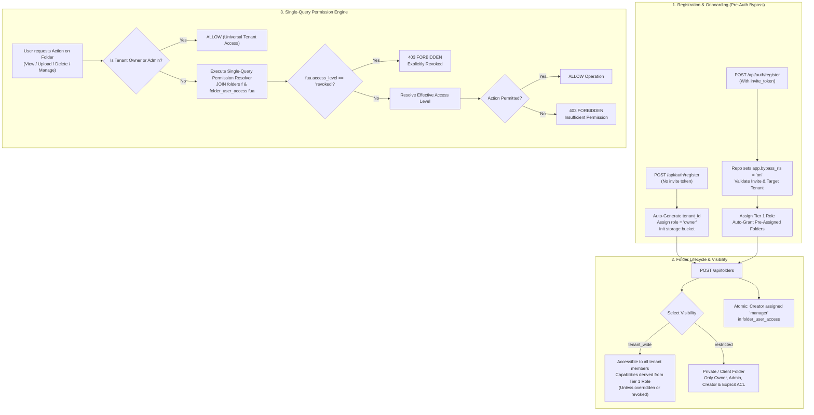

# Enterprise Multi-Tenant RBAC & Folder-Level Access Control Implementation Plan

A comprehensive architectural specification, data model, and implementation roadmap for **Multi-Tenant Role-Based Access Control (RBAC)**, **Granular Folder-Level Access Control (ACL)**, and **Vector Search Pre-Filtering** in the Visual Search API.

Hardened with the 5 critical production trap fixes and designed in accordance with **Backend Architecture**, **SaaS Multi-Tenancy (PostgreSQL RLS)**, and **SaaS Security Posture** engineering standards.

---

## 1. System Architecture & The 5 Production Trap Fixes

### 1.1 The 5 Subtle Production Traps Addressed
1. **RLS Chicken-and-Egg Deadlock on Login & Invite Registration**:
   * *Problem*: `FORCE ROW LEVEL SECURITY` on `users` and `tenant_invites` blocks `SELECT` queries during pre-auth login (`POST /api/auth/login`) or invite signup (`POST /api/auth/register`) because `app.current_tenant_id` is not yet set.
   * *Fix*: Added an explicit session variable guard `current_setting('app.bypass_rls', true) = 'on'` in the RLS policies for `users` and `tenant_invites`.
2. **Missing `revoked` in `folder_access_level`**:
   * *Problem*: An admin could not block a specific user (e.g. an external contractor) from a `tenant_wide` folder without converting the folder to `restricted` and manually re-adding dozens of members.
   * *Fix*: Added `'revoked'` to `folder_access_level`. If `fua.access_level = 'revoked'`, access is immediately denied even on `tenant_wide` folders.
3. **Stale JWT Claims & Instant User Revocation**:
   * *Problem*: Encoding roles purely in JWT tokens allows demoted or offboarded users to continue performing privileged operations until token expiration.
   * *Fix*: Cache `{role, is_active}` in Redis (`user_auth:{tenant_id}:{user_id}`, TTL 5 min) and evict immediately on member role change, deletion, or token revocation.
4. **`photos.photo_count` Concurrency Drift**:
   * *Problem*: Incrementing counters in application code drifts out of sync under concurrent batch uploads and cascades.
   * *Fix*: Added a PostgreSQL trigger `update_folder_photo_count()` (`AFTER INSERT OR DELETE ON photos`) guaranteeing atomic database-level accuracy.
5. **FAISS IDSelector Array Network Overhead**:
   * *Problem*: Querying 200,000 `faiss_id`s from PostgreSQL across the network adds 80–150ms of network serialization latency per search request.
   * *Fix*: Maintain an in-memory `(tenant_id, folder_id) -> np.ndarray[int64]` mapping inside `faiss_engine.py`. Concatenate numpy arrays for allowed folders in `< 0.5ms` with zero DB I/O.

---

## 2. End-to-End System Workflow



---

## 3. Two-Tier Permission Model

### 3.1 Tier 1: Tenant-Wide Roles

| Tenant Role | Description | Default Capabilities Across Accessible Folders |
| :--- | :--- | :--- |
| **`owner`** | Tenant Creator & Organization Owner | Complete unrestricted access, billing management, role delegation, tenant deletion. |
| **`admin`** | Co-Administrator / Team Lead | Full access to all folders, tenant user management, and folder ACL delegation. |
| **`editor`** | Content Manager / Senior Editor | Can create folders, upload photos, and delete *any* photo in accessible folders. |
| **`contributor`**| Standard Photographer / Creator | Can create folders, upload photos, and delete *their own uploaded* photos. |
| **`viewer`** | Client / External Guest (Default) | Can view and search photos in permitted folders. Cannot upload or delete. |

### 3.2 Tier 2: Folder Visibility & Access Overrides

* **Folder Visibility**:
  * `tenant_wide`: Every member of the tenant can access it automatically according to their Tier 1 Role (unless explicit override or revoked).
  * `restricted`: Only Admins, the Folder Creator, and users explicitly assigned in `folder_user_access` can access it.
* **Folder Access Levels (`folder_user_access.access_level`)**:
  * `inherit`: Inherits the user's Tier 1 Tenant Role.
  * **`revoked`**: Explicitly blocks this user from this folder (even if `tenant_wide`).
  * `viewer`: Downgrades an `editor` or `contributor` to read-only for this specific folder.
  * `uploader`: Permits a `viewer` to upload photos to this specific folder without giving them tenant-wide upload rights.
  * `editor`: Permits uploading and deleting any photo inside this specific folder.
  * `manager`: Grants full management (upload, delete, rename folder, grant/revoke access to other members).

### 3.3 Effective Action Matrix

| Feature / Action | `viewer` | `contributor` / `uploader` | `editor` | `manager` (Folder) | `admin` / `owner` (Tenant) | `revoked` |
| :--- | :---: | :---: | :---: | :---: | :---: | :---: |
| **List & View Photos in Folder** | Yes | Yes | Yes | Yes | Yes | **No** |
| **Visual / Vector Search in Folder** | Yes | Yes | Yes | Yes | Yes | **No** |
| **Upload Photos to Folder** | No | Yes | Yes | Yes | Yes | **No** |
| **Delete Own Uploaded Photos** | No | Yes | Yes | Yes | Yes | **No** |
| **Delete Anyone's Photos in Folder** | No | No | Yes | Yes | Yes | **No** |
| **Grant / Revoke Folder Access** | No | No | No | Yes (This folder only) | Yes (All folders) | **No** |
| **Rename or Delete Folder** | No | No | No | Yes (If creator) | Yes (All folders) | **No** |
| **Create New Folders in Tenant** | No | Yes (Auto-manager) | Yes (Auto-manager) | — | Yes | — |
| **Invite / Remove Tenant Members**| No | No | No | No | Yes | — |

---

## 4. PostgreSQL DDL, Triggers & RLS Policies

```sql
-- 1. Enums (including 'revoked')
DO $$ BEGIN
    CREATE TYPE tenant_role AS ENUM ('owner', 'admin', 'editor', 'contributor', 'viewer');
EXCEPTION WHEN duplicate_object THEN NULL; END $$;

DO $$ BEGIN
    CREATE TYPE folder_visibility AS ENUM ('tenant_wide', 'restricted');
EXCEPTION WHEN duplicate_object THEN NULL; END $$;

DO $$ BEGIN
    CREATE TYPE folder_access_level AS ENUM ('inherit', 'revoked', 'viewer', 'uploader', 'editor', 'manager');
EXCEPTION WHEN duplicate_object THEN NULL; END $$;

-- 2. Tenants Table
CREATE TABLE IF NOT EXISTS tenants (
    tenant_id TEXT PRIMARY KEY,
    name TEXT NOT NULL,
    storage_bucket TEXT NOT NULL,
    is_active BOOLEAN NOT NULL DEFAULT TRUE,
    created_at TIMESTAMPTZ NOT NULL DEFAULT NOW(),
    updated_at TIMESTAMPTZ NOT NULL DEFAULT NOW()
);

-- 3. Users Table (Normalized RBAC)
CREATE TABLE IF NOT EXISTS users (
    user_id TEXT PRIMARY KEY,
    tenant_id TEXT NOT NULL REFERENCES tenants(tenant_id) ON DELETE CASCADE,
    username TEXT NOT NULL,
    email TEXT NOT NULL,
    hashed_password TEXT NOT NULL,
    role tenant_role NOT NULL DEFAULT 'viewer',
    storage_bucket TEXT,
    is_active BOOLEAN NOT NULL DEFAULT TRUE,
    created_at TIMESTAMPTZ NOT NULL DEFAULT NOW(),
    last_seen TIMESTAMPTZ NOT NULL DEFAULT NOW(),
    CONSTRAINT uq_tenant_username UNIQUE (tenant_id, username),
    CONSTRAINT uq_global_email UNIQUE (email)
);
CREATE INDEX IF NOT EXISTS idx_users_tenant_role ON users(tenant_id, role);
CREATE INDEX IF NOT EXISTS idx_users_email ON users(email);

-- 4. Folders Table
CREATE TABLE IF NOT EXISTS folders (
    folder_id TEXT PRIMARY KEY,
    tenant_id TEXT NOT NULL REFERENCES tenants(tenant_id) ON DELETE CASCADE,
    folder_name TEXT NOT NULL,
    description TEXT,
    visibility folder_visibility NOT NULL DEFAULT 'restricted',
    photo_count INT NOT NULL DEFAULT 0,
    created_by TEXT REFERENCES users(user_id) ON DELETE SET NULL,
    created_at TIMESTAMPTZ NOT NULL DEFAULT NOW(),
    updated_at TIMESTAMPTZ NOT NULL DEFAULT NOW(),
    CONSTRAINT uq_tenant_folder_name UNIQUE (tenant_id, folder_name)
);
CREATE INDEX IF NOT EXISTS idx_folders_tenant_vis ON folders(tenant_id, visibility);
CREATE INDEX IF NOT EXISTS idx_folders_tenant_name ON folders(tenant_id, folder_name);

-- 5. Folder User Access (Granular ACL overrides)
CREATE TABLE IF NOT EXISTS folder_user_access (
    folder_id TEXT NOT NULL REFERENCES folders(folder_id) ON DELETE CASCADE,
    user_id TEXT NOT NULL REFERENCES users(user_id) ON DELETE CASCADE,
    tenant_id TEXT NOT NULL REFERENCES tenants(tenant_id) ON DELETE CASCADE,
    access_level folder_access_level NOT NULL DEFAULT 'inherit',
    granted_by TEXT REFERENCES users(user_id) ON DELETE SET NULL,
    created_at TIMESTAMPTZ NOT NULL DEFAULT NOW(),
    PRIMARY KEY (folder_id, user_id)
);
CREATE INDEX IF NOT EXISTS idx_folder_access_lookup ON folder_user_access(tenant_id, user_id, folder_id);

-- 6. Tenant Invites (With Instant Folder Pre-Assignment)
CREATE TABLE IF NOT EXISTS tenant_invites (
    invite_id TEXT PRIMARY KEY,
    tenant_id TEXT NOT NULL REFERENCES tenants(tenant_id) ON DELETE CASCADE,
    email TEXT NOT NULL,
    role tenant_role NOT NULL DEFAULT 'viewer',
    initial_folder_ids TEXT[] NOT NULL DEFAULT '{}',
    initial_access_level folder_access_level NOT NULL DEFAULT 'inherit',
    invited_by TEXT REFERENCES users(user_id) ON DELETE SET NULL,
    invite_token TEXT UNIQUE NOT NULL,
    expires_at TIMESTAMPTZ NOT NULL,
    accepted_at TIMESTAMPTZ,
    created_at TIMESTAMPTZ NOT NULL DEFAULT NOW()
);
CREATE INDEX IF NOT EXISTS idx_invites_token ON tenant_invites(invite_token);
CREATE INDEX IF NOT EXISTS idx_invites_tenant_email ON tenant_invites(tenant_id, email);

-- 7. Photos Table
CREATE TABLE IF NOT EXISTS photos (
    image_id TEXT PRIMARY KEY,
    tenant_id TEXT NOT NULL REFERENCES tenants(tenant_id) ON DELETE CASCADE,
    folder_id TEXT NOT NULL REFERENCES folders(folder_id) ON DELETE CASCADE,
    storage_key TEXT NOT NULL,
    filename TEXT NOT NULL,
    uploaded_by TEXT REFERENCES users(user_id) ON DELETE SET NULL,
    faiss_id BIGINT UNIQUE,
    metadata JSONB DEFAULT '{}'::jsonb,
    created_at TIMESTAMPTZ NOT NULL DEFAULT NOW()
);
CREATE INDEX IF NOT EXISTS idx_photos_tenant_folder ON photos(tenant_id, folder_id);
CREATE INDEX IF NOT EXISTS idx_photos_faiss ON photos(tenant_id, faiss_id);

-- 8. Atomic Trigger: Maintain folders.photo_count
CREATE OR REPLACE FUNCTION update_folder_photo_count()
RETURNS TRIGGER AS $$
BEGIN
    IF TG_OP = 'INSERT' THEN
        UPDATE folders SET photo_count = photo_count + 1, updated_at = NOW() WHERE folder_id = NEW.folder_id;
    ELSIF TG_OP = 'DELETE' THEN
        UPDATE folders SET photo_count = GREATEST(0, photo_count - 1), updated_at = NOW() WHERE folder_id = OLD.folder_id;
    END IF;
    RETURN NULL;
END;
$$ LANGUAGE plpgsql;

DROP TRIGGER IF EXISTS trg_photos_count ON photos;
CREATE TRIGGER trg_photos_count
AFTER INSERT OR DELETE ON photos
FOR EACH ROW EXECUTE FUNCTION update_folder_photo_count();

-- 9. Row-Level Security Policies with app.bypass_rls guard
ALTER TABLE tenants ENABLE ROW LEVEL SECURITY;
ALTER TABLE users ENABLE ROW LEVEL SECURITY;
ALTER TABLE folders ENABLE ROW LEVEL SECURITY;
ALTER TABLE folder_user_access ENABLE ROW LEVEL SECURITY;
ALTER TABLE tenant_invites ENABLE ROW LEVEL SECURITY;
ALTER TABLE photos ENABLE ROW LEVEL SECURITY;

ALTER TABLE tenants FORCE ROW LEVEL SECURITY;
ALTER TABLE users FORCE ROW LEVEL SECURITY;
ALTER TABLE folders FORCE ROW LEVEL SECURITY;
ALTER TABLE folder_user_access FORCE ROW LEVEL SECURITY;
ALTER TABLE tenant_invites FORCE ROW LEVEL SECURITY;
ALTER TABLE photos FORCE ROW LEVEL SECURITY;

CREATE POLICY tenant_isolation_tenants ON tenants FOR ALL
    USING (
        tenant_id = NULLIF(current_setting('app.current_tenant_id', true), '')
        OR current_setting('app.bypass_rls', true) = 'on'
    )
    WITH CHECK (
        tenant_id = NULLIF(current_setting('app.current_tenant_id', true), '')
        OR current_setting('app.bypass_rls', true) = 'on'
    );

CREATE POLICY tenant_isolation_users ON users FOR ALL
    USING (
        tenant_id = NULLIF(current_setting('app.current_tenant_id', true), '')
        OR current_setting('app.bypass_rls', true) = 'on'
    )
    WITH CHECK (
        tenant_id = NULLIF(current_setting('app.current_tenant_id', true), '')
        OR current_setting('app.bypass_rls', true) = 'on'
    );

CREATE POLICY tenant_isolation_invites ON tenant_invites FOR ALL
    USING (
        tenant_id = NULLIF(current_setting('app.current_tenant_id', true), '')
        OR current_setting('app.bypass_rls', true) = 'on'
    )
    WITH CHECK (
        tenant_id = NULLIF(current_setting('app.current_tenant_id', true), '')
        OR current_setting('app.bypass_rls', true) = 'on'
    );

CREATE POLICY tenant_isolation_folders ON folders FOR ALL
    USING (tenant_id = NULLIF(current_setting('app.current_tenant_id', true), ''))
    WITH CHECK (tenant_id = NULLIF(current_setting('app.current_tenant_id', true), ''));

CREATE POLICY tenant_isolation_fua ON folder_user_access FOR ALL
    USING (tenant_id = NULLIF(current_setting('app.current_tenant_id', true), ''))
    WITH CHECK (tenant_id = NULLIF(current_setting('app.current_tenant_id', true), ''));

CREATE POLICY tenant_isolation_photos ON photos FOR ALL
    USING (tenant_id = NULLIF(current_setting('app.current_tenant_id', true), ''))
    WITH CHECK (tenant_id = NULLIF(current_setting('app.current_tenant_id', true), ''));
```

---

## 5. Single-Query Permission & Accessible Folders Resolver

```sql
SELECT 
    f.folder_id,
    f.folder_name,
    f.description,
    f.visibility,
    f.photo_count,
    f.created_by,
    f.created_at,
    CASE
        WHEN $3 IN ('owner', 'admin') THEN 'manager'::folder_access_level
        WHEN fua.access_level IS NOT NULL AND fua.access_level != 'inherit' THEN fua.access_level
        WHEN $3 = 'editor' THEN 'editor'::folder_access_level
        WHEN $3 = 'contributor' THEN 'uploader'::folder_access_level
        ELSE 'viewer'::folder_access_level
    END AS effective_access
FROM folders f
LEFT JOIN folder_user_access fua 
       ON f.folder_id = fua.folder_id AND fua.user_id = $1
WHERE f.tenant_id = $2
  AND (
      $3 IN ('owner', 'admin')
      OR (
          COALESCE(fua.access_level, 'inherit') != 'revoked'
          AND (f.visibility = 'tenant_wide' OR fua.user_id IS NOT NULL)
      )
  );
```
*(Query Parameters: `$1 = user_id`, `$2 = tenant_id`, `$3 = user.tenant_role`)*

---

## 6. Implementation Roadmap

1. **Phase 1: Database Migration & Repository Updates** (`postgres_repository.py`)
   - Add ENUMs (with `'revoked'`), tables, trigger for `photo_count`, and pre-auth RLS bypass policies.
   - Update in-memory fallback dictionaries (`_mem_folders`, `_mem_folder_access`, etc.) to maintain zero-dependency unit testing support.
2. **Phase 2: Permission Guards & Dependencies** (`src/api/dependencies/permissions.py`)
   - Implement Single-Query Resolver function and `require_folder_permission()` dependency.
3. **Phase 3: Auth & Zero-Friction Invites** (`src/api/auth_routes.py`, `user_auth_service.py`)
   - Pre-auth lookup with `app.bypass_rls = 'on'`.
   - Atomic invite token consumption and folder pre-assignment.
   - Instant Redis cache invalidation on role demotion or member removal.
4. **Phase 4: Folder Management & Bulk ACL Router** (`src/api/folder_routes.py`)
   - Complete CRUD endpoints for folders.
   - Bulk assignment endpoint (`POST /api/folders/access/bulk`).
   - Creator auto-granted `manager` access.
5. **Phase 5: Route Enforcement** (`upload_routes.py`, `search_routes.py`, `faiss_engine.py`)
   - Folder-level upload checks on `/api/upload/photo` and `/api/upload/batch`.
   - In-memory `(tenant_id, folder_id) -> np.ndarray[int64]` mapping in `faiss_engine.py` for sub-millisecond vector pre-filtering without DB queries.
6. **Phase 6: Automated Test Suite** (`tests/test_phase4_rbac_and_folders.py`)
   - Verification of login without tenant context, explicit revocation exclusion, atomic photo counter trigger, and scoped FAISS search.
