# Decoupled Multi-Tenant Onboarding & Cross-Tenant Membership Architecture Plan

**Document Version:** 2.1  
**Target Architecture:** Multi-Tenant B2B SaaS, Strict Row-Level Security (RLS), Granular RBAC  
**Status:** Architecture Blueprint & Implementation Specification  

---

## 1. Architectural Assessment: How Important Is This Implementation?

### Verdict: **CRITICAL / P0 for Production B2B SaaS**

Combining organization/tenant creation and invited member onboarding into a single polymorphic `POST /api/auth/register` endpoint is a well-known anti-pattern in B2B SaaS engineering that introduces severe production defects:

```
+---------------------------------------------------------------------------------------------------------+
|                                    FAILURE MODES OF COMBINED /register                                  |
+-----------------------------------+---------------------------------------------------------------------+
| 1. "Accidental Orphan Tenants"    | An invited user misses clicking the invite link and goes directly to |
|    (Data Fragmentation)           | the sign-up page. The system creates a brand new isolated tenant      |
|                                   | and database namespace instead of adding them to the company team.  |
|                                   | Result: User sees an empty workspace and support tickets spike.     |
+-----------------------------------+---------------------------------------------------------------------+
| 2. Invite Email Hijacking         | In generic registration, if user inputs a different email than the   |
|    (Security / IDOR Risk)         | one invited along with an invite_token, an unauthorized email gains  |
|                                   | company access unless strictly guarded. Decoupled onboarding pulls  |
|                                   | the email directly from the DB record, guaranteeing 0% spoofing.     |
+-----------------------------------+---------------------------------------------------------------------+
| 3. Degraded Frontend / UX         | Generic registration forces forms to juggle conditional validation:  |
|    (Form Ambiguity)               | "Is company name required? Only if no invite token. Is role passed?  |
|                                   | Should a user pick their role? No!" Splitting cleanly yields zero   |
|                                   | ambiguous frontend code.                                            |
+-----------------------------------+---------------------------------------------------------------------+
| 4. Cross-Tenant Freelancer Access | Expert photographers, external editors, and clients frequently work |
|    (Scoped Identity)              | across multiple studios (e.g., Studio A and Studio B). Scoping email |
|                                   | uniqueness per tenant (tenant_id, email) enables multi-tenant        |
|                                   | membership without duplicate emails colliding globally.             |
+-----------------------------------+---------------------------------------------------------------------+
```

---

## 2. Decoupled Architecture & User Flows

```mermaid
flowchart TD
    subgraph OwnerFlow["Flow 1: Founding Admin Registration (POST /api/auth/register-tenant)"]
        O1["POST /api/auth/register-tenant<br/>{username, email, password, organization_name}"] --> O2{"Active pending invite<br/>for this email elsewhere?"}
        O2 -->|"Yes & ignore_pending_invite=False"| O_Warn["409 Conflict:<br/>'You have a pending invite to join Studio X.<br/>Use your invite link or set ignore_pending_invite=True'"]
        O2 -->|"No (or ignore_pending_invite=True)"| O3["Atomic DB Transaction:<br/>1. Generate tenant_id (tenant_xxxxxxxxxxxx)<br/>2. INSERT INTO tenants<br/>3. INSERT INTO users (role = 'owner')<br/>4. Seed default 'general' folder (manager)"]
        O3 --> O4["Return TokenResponse<br/>(role='owner', tenant_id, organization_name)"]
    end

    subgraph MemberFlow["Flow 2: Invited Member Onboarding (GET + POST /accept-invite)"]
        M1["GET /api/auth/invites/{invite_token}<br/>(Frontend displays Studio Name + Locked Email)"] --> M2{"Is token valid, unaccepted,<br/>and unexpired?"}
        M2 -->|"No"| M_Block["400 Bad Request:<br/>'Invite link is invalid, expired, or already used'"]
        M2 -->|"Yes"| M3["POST /api/auth/accept-invite<br/>{invite_token, username, password}"]
        M3 --> M4["Atomic DB Transaction:<br/>1. Verify token & read email, tenant_id, role, folders<br/>2. INSERT INTO users bound to tenant_id (email locked from invite!)<br/>3. Bulk INSERT into folder_user_access (initial_folder_ids)<br/>4. UPDATE tenant_invites SET accepted_at = NOW()"]
        M4 --> M5["Return TokenResponse<br/>(role=assigned_role, tenant_id, organization_name)"]
    end

    subgraph LoginFlow["Flow 3: Unified Login & Tenant Disambiguation (POST /api/auth/login)"]
        L1["POST /api/auth/login<br/>{email, password, optional tenant_id}"] --> L2["RLS Bypass Lookup (app.bypass_rls = 'on')<br/>Find users by email & verify password"]
        L2 --> L3{"Does user belong to<br/>multiple tenants?"}
        L3 -->|"Yes and tenant_id NOT provided"| L4["Return 200 MultiTenantLoginResponse<br/>{status: 'select_tenant', available_tenants: [...]}<br/>Frontend shows workspace picker modal"]
        L3 -->|"Single tenant OR tenant_id provided"| L5["Issue JWT TokenResponse<br/>(user_id, tenant_id, role, organization_name)"]
    end

    subgraph SwitchFlow["Flow 4: Workspace Switching (POST /api/auth/switch-tenant)"]
        S1["POST /api/auth/switch-tenant<br/>Bearer Token + {tenant_id}"] --> S2{"Does caller email have active<br/>account in target tenant_id?"}
        S2 -->|"No"| S_Deny["403 Forbidden:<br/>'Not a member of this workspace'"]
        S2 -->|"Yes"| S3["Issue new JWT TokenResponse<br/>scoped to target tenant_id"]
    end
```



---

## 3. Database Schema & Constraint Fixes (`postgres_repository.py`)

### 3.1 DDL Changes: Scoping Email Uniqueness Per Tenant

Currently, a global `UNIQUE (email)` constraint blocks an invited freelancer with `freelancer@gmail.com` from accepting an invite to a second tenant if they already belong to a first tenant.

**The Fix:** Replace global email uniqueness with composite per-tenant constraints:

```sql
-- 1. Drop legacy global email uniqueness constraint if present
ALTER TABLE users DROP CONSTRAINT IF EXISTS uq_global_email;
ALTER TABLE users DROP CONSTRAINT IF EXISTS uq_users_email;
ALTER TABLE users DROP CONSTRAINT IF EXISTS users_email_key;

-- 2. Add per-tenant uniqueness constraints
ALTER TABLE users ADD CONSTRAINT uq_tenant_email UNIQUE (tenant_id, email);
ALTER TABLE users ADD CONSTRAINT uq_tenant_username UNIQUE (tenant_id, username);

-- 3. Composite index for fast pre-auth login lookups across all tenant memberships
CREATE INDEX IF NOT EXISTS idx_users_email_global ON users (LOWER(email)) WHERE is_active = TRUE;
```

### 3.2 Pre-Auth Queries With RLS Bypass (`SET LOCAL app.bypass_rls = 'on'`)

Because login and invite token verification occur before the user has a JWT (so `app.current_tenant_id` is empty), these queries execute inside `get_bypass_rls_connection()`:

```sql
-- Query 1: repo.get_invite_by_token(invite_token)
-- Fetches invite record and joins tenant name for the invite preview landing page
SELECT 
    ti.invite_id,
    ti.tenant_id,
    t.name AS organization_name,
    t.storage_bucket,
    ti.email,
    ti.role,
    ti.initial_folder_ids,
    ti.initial_access_level,
    ti.invited_by,
    ti.expires_at,
    ti.accepted_at
FROM tenant_invites ti
JOIN tenants t ON ti.tenant_id = t.tenant_id
WHERE ti.invite_token = $1;

-- Query 2: repo.get_active_invite_by_email(email)
-- Checks for pending unaccepted invites to prevent accidental orphan tenant creation
SELECT 
    ti.invite_id,
    ti.tenant_id,
    t.name AS organization_name,
    ti.role,
    ti.expires_at
FROM tenant_invites ti
JOIN tenants t ON ti.tenant_id = t.tenant_id
WHERE LOWER(ti.email) = LOWER($1)
  AND ti.accepted_at IS NULL
  AND ti.expires_at > NOW()
ORDER BY ti.created_at DESC
LIMIT 1;

-- Query 3: repo.get_users_by_email_preauth(email)
-- Returns all active tenant accounts for an email globally (supports multi-tenant login)
SELECT 
    u.user_id,
    u.tenant_id,
    u.username,
    u.email,
    u.hashed_password,
    u.role,
    u.is_active,
    u.storage_bucket,
    u.created_at,
    u.last_seen,
    t.name AS organization_name
FROM users u
JOIN tenants t ON u.tenant_id = t.tenant_id
WHERE LOWER(u.email) = LOWER($1) AND u.is_active = TRUE;
```

---

## 4. Pydantic Schemas (`src/schemas/auth_schemas.py`)

```python
from enum import Enum
from typing import List, Optional, Union
from pydantic import BaseModel, Field, EmailStr

class TenantRole(str, Enum):
    OWNER = "owner"
    ADMIN = "admin"
    EDITOR = "editor"
    CONTRIBUTOR = "contributor"
    VIEWER = "viewer"

class FolderVisibility(str, Enum):
    TENANT_WIDE = "tenant_wide"
    RESTRICTED = "restricted"

class FolderAccessLevel(str, Enum):
    INHERIT = "inherit"
    REVOKED = "revoked"
    VIEWER = "viewer"
    UPLOADER = "uploader"
    EDITOR = "editor"
    MANAGER = "manager"

# ── 1. Founding Admin (New Tenant) Registration ─────────────────────
class RegisterTenantRequest(BaseModel):
    username: str = Field(..., min_length=3, max_length=50, pattern=r"^[a-zA-Z0-9_\-]+$", examples=["alex_founder"])
    email: EmailStr = Field(..., examples=["alex@studiopro.com"])
    password: str = Field(..., min_length=8, examples=["SecurePass123!"])
    organization_name: str = Field(..., min_length=2, max_length=100, examples=["Studio Pro NYC"])
    ignore_pending_invite: bool = Field(
        False,
        description="If True, permits creating a new tenant even if this email has an active pending invite elsewhere"
    )

# ── 2. Invited Member Onboarding ────────────────────────────────────
class InvitePreviewResponse(BaseModel):
    invite_id: str
    tenant_id: str
    organization_name: str
    email: EmailStr
    role: TenantRole
    expires_at: str

class AcceptInviteRequest(BaseModel):
    invite_token: str = Field(..., min_length=16, description="Cryptographic token from invite link")
    username: str = Field(..., min_length=3, max_length=50, pattern=r"^[a-zA-Z0-9_\-]+$", examples=["sarah_photographer"])
    password: str = Field(..., min_length=8, examples=["MemberSecure123!"])

# ── 3. Unified Authentication, Disambiguation & Token Responses ─────
class LoginRequest(BaseModel):
    email: EmailStr
    password: str
    tenant_id: Optional[str] = Field(None, description="Optional tenant_id to select workspace directly when user belongs to multiple organizations")

class TenantOptionItem(BaseModel):
    tenant_id: str
    organization_name: str
    role: str

class TokenResponse(BaseModel):
    access_token: str
    token_type: str = "bearer"
    user_id: str
    username: str
    email: EmailStr
    role: str
    tenant_id: str
    organization_name: str

class MultiTenantLoginResponse(BaseModel):
    status: str = "select_tenant"
    message: str = "Multiple workspace memberships found. Please select which workspace to enter."
    available_tenants: List[TenantOptionItem]

class SwitchTenantRequest(BaseModel):
    tenant_id: str = Field(..., description="Target organization/workspace ID to switch active session to")

class UserProfileResponse(BaseModel):
    user_id: str
    tenant_id: str
    organization_name: str
    username: str
    email: str
    role: str
    storage_bucket: Optional[str] = None
    created_at: str
    last_seen: Optional[str] = None
```

---

## 5. API Endpoints Specification (`src/api/auth_routes.py`)

| Method | Endpoint | Auth Required | Request Body | Response Model | HTTP Status | Description |
|---|---|---|---|---|---|---|
| `POST` | `/api/auth/register-tenant` | **No** (Public) | `RegisterTenantRequest` | `TokenResponse` | `201 Created` | Creates new organization, user `owner`, seeds default folder |
| `GET` | `/api/auth/invites/{token}` | **No** (Public) | None | `InvitePreviewResponse` | `200 OK` | Validates token and returns org name + email for signup UI |
| `POST` | `/api/auth/accept-invite` | **No** (Public) | `AcceptInviteRequest` | `TokenResponse` | `201 Created` | Binds user to invited tenant, grants initial folders |
| `POST` | `/api/auth/login` | **No** (Public) | `LoginRequest` | `Union[TokenResponse, MultiTenantLoginResponse]` | `200 OK` | Authenticates user; if multi-workspace without tenant_id, prompts workspace selection |
| `POST` | `/api/auth/switch-tenant` | **Yes** (Bearer) | `SwitchTenantRequest` | `TokenResponse` | `200 OK` | Issues new JWT scoped to another workspace the user belongs to |
| `GET` | `/api/auth/me` | **Yes** (Bearer) | None | `UserProfileResponse` | `200 OK` | Returns caller profile, tenant ID, and organization name |

> [!NOTE]
> The legacy endpoint `POST /api/auth/register` is completely eliminated from the API router as requested.

---

## 6. Implementation Checklist & Verification Strategy

- [ ] **Step 1: Schemas (`src/schemas/auth_schemas.py` & `src/schemas/__init__.py`)**
  - Add `RegisterTenantRequest`, `InvitePreviewResponse`, `AcceptInviteRequest`, `TenantOptionItem`, `MultiTenantLoginResponse`, `SwitchTenantRequest`.
  - Update `TokenResponse` and `UserProfileResponse` to include `organization_name`.
  - Remove legacy `RegisterRequest`.
- [ ] **Step 2: Database Repository Layer (`src/modules/infra/postgres_repository.py`)**
  - Update DDL in `init_postgres_tables()`: replace `uq_global_email` with `uq_tenant_email UNIQUE (tenant_id, email)`.
  - Implement `get_invite_by_token(invite_token: str)` (joining `tenants` for `organization_name`).
  - Implement `get_active_invite_by_email(email: str)` (returns active pending invite + org name).
  - Implement `get_users_by_email_preauth(email: str)` (returns all active accounts matching email).
  - Update in-memory fallback stores (`_mem_invites`, `_mem_tenants`, `_mem_users`) for full parity with per-tenant email uniqueness.
- [ ] **Step 3: Service Layer (`src/services/user_auth_service.py`)**
  - Implement `register_tenant(req: RegisterTenantRequest) -> Dict[str, Any]`:
    - Checks pending invites (409 Conflict if found and `ignore_pending_invite=False`).
    - Creates tenant, owner user, and seeds general folder.
  - Implement `preview_invite(invite_token: str) -> Dict[str, Any]`:
    - Validates token is unaccepted and not expired.
  - Implement `accept_invite(req: AcceptInviteRequest) -> Dict[str, Any]`:
    - Validates token, locks email from invite row.
    - Prevents duplicate `(tenant_id, email)` or `(tenant_id, username)`.
    - Atomically creates user, auto-grants assigned folders, and marks invite accepted.
  - Implement `authenticate(email: str, password: str, tenant_id: Optional[str] = None)`:
    - Resolves multi-tenant accounts and disambiguates workspace selection.
  - Implement `switch_tenant(user_id: str, email: str, target_tenant_id: str) -> Dict[str, Any]`.
- [ ] **Step 4: API Router (`src/api/auth_routes.py`)**
  - Delete legacy `POST /api/auth/register`.
  - Mount `POST /api/auth/register-tenant`, `GET /api/auth/invites/{invite_token}`, `POST /api/auth/accept-invite`, `POST /api/auth/switch-tenant`.
  - Update `POST /api/auth/login` and `GET /api/auth/me`.
- [ ] **Step 5: Automated Test Suite Updates**
  - Update `tests/test_phase4_rbac_and_folders.py`, `tests/integration/test_mvc_services_and_api.py`, and `tests/unit/test_schemas.py`.
  - Test multi-tenant freelancer scenario: user accepts invites to Studio A and Studio B with the same email, successfully switches tenants, and is isolated by RLS.
  - Execute full test suite via Docker to confirm 100% pass rate.
