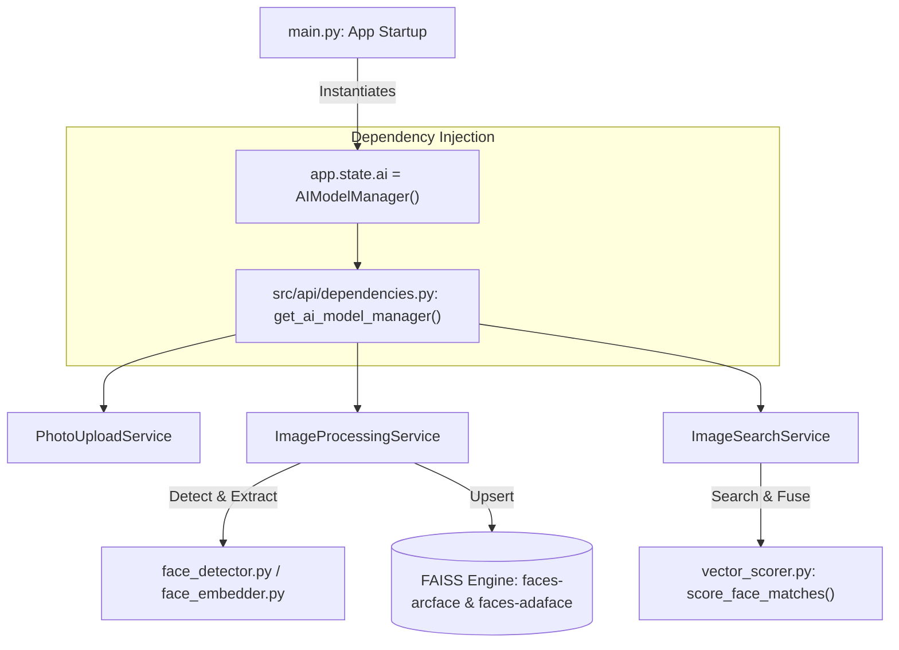

# Comprehensive Architectural Guide: `src/services/ai_manager.py`

This document details every function inside [`src/services/ai_manager.py`](file:///home/sudhanshu/Desktop/visual-search-api/src/services/ai_manager.py), explaining **what each function does**, **the engineering rationale**, and **how to use it within the existing modular services**.

---

## Architecture Overview

`ai_manager.py` is the **core neural engine** of the Visual Search API. It orchestrates four models:
1. **InsightFace (`buffalo_l`)**: Face detection (SCRFD) and 512-dimensional ArcFace identity embedding.
2. **AdaFace (`cvlface_adaface_ir50_ms1mv2`)**: Quality-adaptive 512-dimensional face recognition for degraded/angled faces.
3. **YOLOv11-seg (`yolo11n-seg.pt`)**: Person segmentation and object/scene region bounding box proposal.
4. **Multimodal Visual Embedders**:
   - **DINOv2 (`facebook/dinov2-base`)**: 768-dimensional geometric/structure visual representation.
   - **SigLIP (`google/siglip-base-patch16-224`)**: 768-dimensional semantic image embedding.

---

## 1. Top-Level Utility Functions (Lines 51 – 190)

### 1.1 `_estimate_norm_fast(lmk: np.ndarray, image_size: int = 112) -> np.ndarray`
* **What it does**: Computes a $2 \times 3$ affine transformation matrix to align 5 facial landmarks (left eye, right eye, nose, left mouth corner, right mouth corner) to a canonical 2D face template.
* **Why it exists**: The standard InsightFace library uses `np.linalg.lstsq` per face, which is slow on CPU. This function replaces it with `cv2.estimateAffinePartial2D(method=cv2.LSQR_EXACT)`, running **~10x faster** with exact precision.
* **How to use it**:
  ```python
  from src.services.ai_manager import _estimate_norm_fast
  # lmk is (5, 2) facial landmarks from detector
  affine_matrix = _estimate_norm_fast(face.kps, image_size=112)
  ```

---

### 1.2 `_align_face_fast(bgr: np.ndarray, kps: np.ndarray, size: int = 112) -> np.ndarray`
* **What it does**: Takes the full BGR image and facial landmarks, calculates the affine matrix via `_estimate_norm_fast`, and warps the face crop into a standardized, upright $112 \times 112$ square.
* **Why it exists**: Facial recognition models (ArcFace/AdaFace) require upright, scale-normalized facial features.
* **How to use it**:
  ```python
  from src.services.ai_manager import _align_face_fast
  aligned_face_bgr = _align_face_fast(image_bgr, face.kps, size=112)
  ```

---

### 1.3 `_resize_pil(img: Image.Image, max_side: int = MAX_IMAGE_SIZE) -> Image.Image`
* **What it does**: Proportionally resizes large PIL images so the longest dimension is capped at `max_side` (default: 1024px) using high-quality Lanczos resampling.
* **Why it exists**: Prevents excessive memory consumption and slow inference when processing large smartphone or DSLR photos (e.g., 48MP photos).
* **How to use it**:
  ```python
  from src.services.ai_manager import _resize_pil
  pil_img = _resize_pil(pil_img, max_side=1024)
  ```

---

### 1.4 `_blur_score(bgr: np.ndarray, x1: int, y1: int, x2: int, y2: int) -> float`
* **What it does**: Extracts the bounding box region `[y1:y2, x1:x2]`, converts it to a normalized $64 \times 64$ grayscale patch, and computes the variance of the Laplacian:
  $$\text{Blur Score} = \text{Var}(\nabla^2 I)$$
* **Why it exists**: Quantifies image sharpness. Values $< 30$ are blurry/defocused; $> 100$ are sharp. Used by the quality gate to reject unmatchable face crops and select medoid representatives during clustering.
* **How to use it**:
  ```python
  from src.services.ai_manager import _blur_score
  score = _blur_score(image_bgr, x1, y1, x2, y2)
  if score < 30.0:
      print("Face too blurry for reliable identification")
  ```

---

### 1.5 `_crop_to_b64(img_bgr: np.ndarray, x1: int, y1: int, x2: int, y2: int) -> str`
* **What it does**: Crops a face with configured padding (`FACE_CROP_PADDING = 0.2`), converts BGR to RGB, resizes to a $112 \times 112$ thumbnail, encodes as JPEG (quality 85), and returns a Base64 ASCII string.
* **Why it exists**: Embeds face thumbnail previews directly into API JSON responses and gallery cards without requiring a separate network request to disk or CDN.
* **How to use it**:
  ```python
  from src.services.ai_manager import _crop_to_b64
  b64_thumbnail = _crop_to_b64(image_bgr, x1, y1, x2, y2)
  ```

---

### 1.6 `_face_crop_for_adaface(img_bgr: np.ndarray, x1: int, y1: int, x2: int, y2: int) -> np.ndarray | None`
* **What it does**: Crops the face with tighter padding (`ADAFACE_CROP_PADDING = 0.1`), converts BGR $\to$ RGB, resizes to $112 \times 112$, normalizes pixel values to $[-1.0, 1.0]$ via $(x/255.0 - 0.5) / 0.5$, and transposes to Channel-First format `(3, 112, 112)`.
* **Why it exists**: Preprocesses raw image bytes into the exact mathematical tensor input expected by the AdaFace ResNet backbone.
* **How to use it**:
  ```python
  from src.services.ai_manager import _face_crop_for_adaface
  chw_tensor_np = _face_crop_for_adaface(image_bgr, x1, y1, x2, y2)
  ```

---

### 1.7 `_clahe_enhance(bgr: np.ndarray) -> np.ndarray`
* **What it does**: Applies Contrast Limited Adaptive Histogram Equalization (CLAHE) on the Luminance (`L`) channel in LAB color space:
  - Clip limit: `2.0`, Grid size: `(8, 8)`.
* **Why it exists**: Equalizes severe shadows, dark backlighting, or harsh direct sunlight while avoiding noise overamplification, dramatically improving face detection recall on dark or high-contrast photos.
* **How to use it**:
  ```python
  from src.services.ai_manager import _clahe_enhance
  enhanced_bgr = _clahe_enhance(image_bgr)
  ```

---

### 1.8 `_iou(box_a: list, box_b: list) -> float`
* **What it does**: Computes Intersection over Union ($IoU$) between two bounding boxes:
  $$\text{IoU} = \frac{\text{Area}(A \cap B)}{\text{Area}(A \cup B)}$$
* **Why it exists**: Used by Non-Maximum Suppression (`_dedup_faces`) to eliminate duplicate detections of the same face across multi-scale passes.
* **How to use it**:
  ```python
  from src.services.ai_manager import _iou
  overlap = _iou([10, 10, 50, 50], [15, 15, 55, 55])
  ```

---

### 1.9 `_dedup_faces(faces_list: list, iou_thresh: float = IOU_DEDUP_THRESHOLD) -> list`
* **What it does**: Sorts detected faces descending by detection confidence score (`det_score`) and keeps only boxes whose $IoU$ with already accepted boxes is below `iou_thresh` (default: 0.4).
* **Why it exists**: When the detector runs across multiple scales (640, 960, 1280), the same face is detected multiple times. `_dedup_faces` ensures each human face appears only once.
* **How to use it**:
  ```python
  from src.services.ai_manager import _dedup_faces
  unique_faces = _dedup_faces(raw_faces, iou_thresh=0.4)
  ```

---

### 1.10 `_face_cache_get(key: str)`, `_face_cache_set(key: str, vec: np.ndarray)`, `_crop_hash(crop_bgr: np.ndarray)`
* **What it does**: Thread-safe in-memory LRU cache storing up to 512 face embeddings keyed by MD5 pixel hash.
* **Why it exists**: If the same person's identical face crop is processed repeatedly (or query cache hits occur), re-running inference on CPU/GPU is avoided.
* **How to use it**:
  ```python
  from src.services.ai_manager import _crop_hash, _face_cache_get, _face_cache_set
  h = _crop_hash(crop_bgr)
  cached = _face_cache_get(h)
  if cached is None:
      _face_cache_set(h, computed_vector)
  ```

---

## 2. `AIModelManager` Class Methods (Lines 191 – 637)

### 2.1 `__init__(self)`
* **What it does**:
  1. Detects compute device (`cuda` if GPU available, else `cpu`).
  2. Initializes ONNX vision stack or loads HuggingFace `SigLIP` and `DINOv2` models.
  3. Loads YOLOv11 segmentation model (`yolo11n-seg.pt`).
  4. Loads InsightFace `buffalo_l` face analysis stack (SCRFD + ArcFace).
  5. Triggers `_load_adaface()`.
  6. Creates a 2-worker `ThreadPoolExecutor` to run ArcFace and AdaFace simultaneously.
* **Existing System Usage**: Instantiated once as a singleton during application startup in `main.py` and attached to `app.state.ai`.

---

### 2.2 `_load_adaface(self) -> None`
* **What it does**:
  1. Checks `ENABLE_ADAFACE` flag.
  2. Downloads AdaFace model weights (`minchul/cvlface_adaface_ir50_ms1mv2`) from HuggingFace to `~/.cvlface_cache/`.
  3. Loads the PyTorch iResNet-50 architecture and sets `self.adaface_model.eval()`.
  4. Gracefully catches exceptions without crashing if offline.
* **Existing System Usage**: Invoked automatically inside `__init__()`.

---

### 2.3 `_adaface_embed_batch(self, face_arrs_chw: list[np.ndarray | None]) -> list[np.ndarray | None]`
* **What it does**:
  1. Collects valid `(3, 112, 112)` face arrays and stacks them into a single PyTorch tensor batch.
  2. Runs forward pass through `self.adaface_model`.
  3. Applies L2-normalization: $v_{\text{norm}} = \frac{v}{\|v\|_2}$.
  4. Maps outputs back to the original index positions.
* **Existing System Usage**: Called in parallel with ArcFace during face detection in `detect_faces()` ([`src/modules/vision/face_detector.py`](file:///home/sudhanshu/Desktop/visual-search-api/src/modules/vision/face_detector.py)).
* **Direct Call Example**:
  ```python
  crops = [_face_crop_for_adaface(cv_img, x1, y1, x2, y2)]
  ada_vectors = ai._adaface_embed_batch(crops)
  ```

---

### 2.4 `_arcface_embed_batch(self, faces: list, bgr: np.ndarray) -> list[np.ndarray]`
* **What it does**:
  1. Iterates over InsightFace detected `Face` objects.
  2. Checks the LRU face crop cache.
  3. Normalizes vectors to unit length (512D).
  4. Caches and returns the batch of 512D ArcFace embeddings.
* **Existing System Usage**: Called in `_detect_and_encode_faces()`.

---

### 2.5 `_embed_crops_batch(self, crops: list[Image.Image]) -> list[np.ndarray]`
* **What it does**:
  1. Takes PIL image crops (e.g., extracted objects or whole scenes).
  2. Passes crops through **SigLIP** (semantic understanding) and **DINOv2** (structural visual features).
  3. Concatenates both embeddings and L2-normalizes into a composite vector.
* **Existing System Usage**: Powers the object/scene search lane (`IDX_OBJECTS`) in `image_processing_service.py` and `image_search_service.py`.
* **Direct Call Example**:
  ```python
  obj_vectors = ai._embed_crops_batch([pil_crop])
  ```

---

### 2.6 `_run_detection_at_scale(self, bgr_enhanced: np.ndarray, scale: tuple) -> list`
* **What it does**:
  1. Resizes input image preserving aspect ratio to fit the target canvas size (e.g., $640\times640$, $960\times960$, or $1280\times1280$).
  2. Acquires thread lock (`self._face_lock`) to prevent race conditions.
  3. Runs `self.face_app.get(bgr_scaled)`.
  4. Rescales coordinates back to the original unscaled image dimensions.
* **Existing System Usage**: Core subroutine for multi-scale face detection fallback.

---

### 2.7 `_detect_and_encode_faces(self, img_np: np.ndarray) -> list[dict]`
* **What it does**:
  1. Converts RGB to BGR and applies CLAHE enhancement.
  2. Runs multi-scale face detection with horizontal flip augmentation.
  3. Deduplicates bounding boxes via IoU.
  4. Filters faces by minimum size (`MIN_FACE_SIZE = 30`), quality gate (`FACE_QUALITY_GATE = 0.3`), and blur threshold.
  5. **Submits both ArcFace and AdaFace to the thread pool concurrently**.
  6. Returns a list of standardized dictionaries:
     ```python
     {
         "type": "face",
         "face_idx": int,
         "bbox": [x, y, w, h],
         "face_crop": "base64...",
         "det_score": float,
         "blur_score": float,
         "arcface_vector": np.ndarray,  # 512D
         "adaface_vector": np.ndarray,  # 512D
         "has_adaface": bool
     }
     ```
* **Existing System Usage**: The primary engine used by `process_image_bytes()` and `face_detector.py`.

---

### 2.8 `process_image_bytes(self, image_bytes: bytes, detect_faces: bool = True) -> list[dict]`
* **What it does**:
  1. Calculates MD5 hash of raw image bytes for caching.
  2. Corrects EXIF orientation tags (rotates phone photos correctly).
  3. Calls `_detect_and_encode_faces()` for human faces.
  4. Runs YOLOv11 segmentation to extract objects and background scenes.
  5. Computes SigLIP + DINOv2 embeddings for detected objects.
  6. Returns full multimodal extraction records.
* **Existing System Usage**: Used in background batch processing jobs (`jobs.py`) and upload ingestion pipelines.

---

### 2.9 `process_image_bytes_async(self, image_bytes: bytes, detect_faces: bool = True) -> list[dict]`
* **What it does**: Non-blocking `async` wrapper around `process_image_bytes()`. Runs CPU/GPU inference in a thread pool executor to avoid freezing the FastAPI asyncio event loop.
* **Existing System Usage**: Ideal for asynchronous FastAPI endpoints:
  ```python
  results = await ai.process_image_bytes_async(file_bytes)
  ```

---

## 3. How to Use `AIModelManager` in the Existing Services



### Example: Calling from any Route or Service
```python
from src.api.dependencies import get_ai_model_manager
from src.modules.vision.face_detector import detect_faces
from src.modules.vision.face_embedder import extract_face_embeddings

# 1. Obtain manager instance
ai = get_ai_model_manager(request)

# 2. Detect faces with dual ArcFace + AdaFace support
faces = detect_faces(ai, cv_image)

# 3. Extract normalized vectors
for f in faces:
    emb = extract_face_embeddings(ai, f["face_obj"])
    arc_vec = emb["arcface_vector"]   # 512D
    ada_vec = emb["adaface_vector"]   # 512D
```

