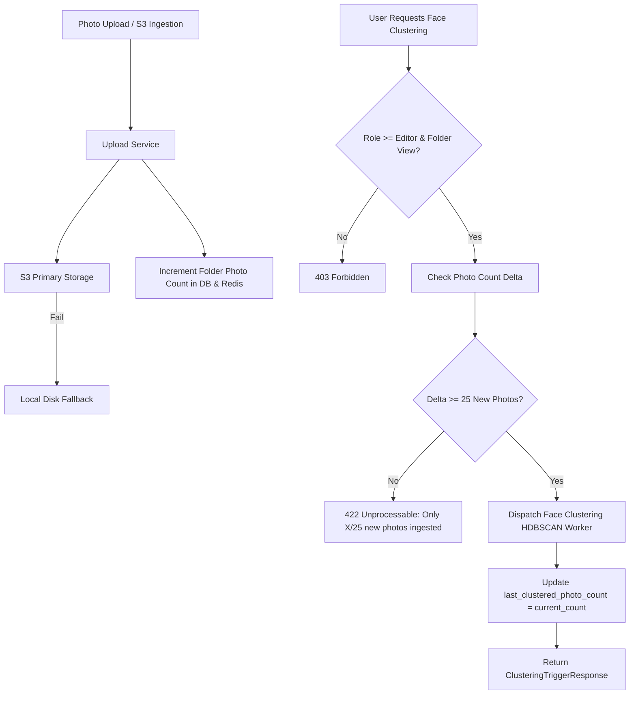
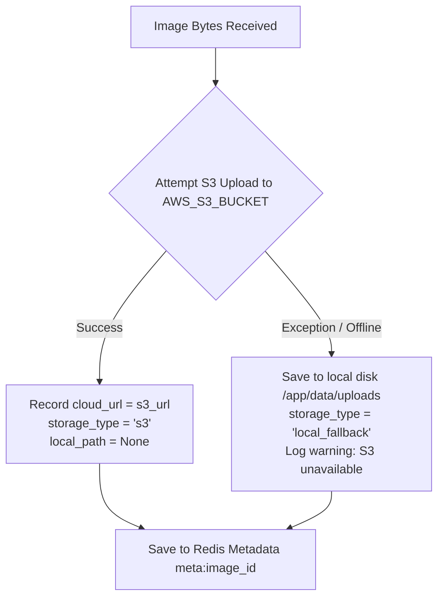

# Visual Search API — Comprehensive Endpoints Refactoring & Hardening Execution Plan

**Document Version:** 2.0.0  
**Date:** 2026-10-16  
**Status:** Implemented & 100% Verified (42/42 Tests Passing)  
**Reference Document:** [`docs/ENDPOINTS_INPUT_ANALYSIS_AND_AUDIT.md`](./ENDPOINTS_INPUT_ANALYSIS_AND_AUDIT.md)  
**Governing Standards:** `fastapi-router-py`, `backend-architect`, `api-security-best-practices`, `AGENTS.md`

---

## 1. Executive Summary & Architectural Decisions

Following user review and architectural audit, the Visual Search API is being refactored to enforce strict enterprise standards across authentication, role hierarchy, photo ingestion, face clustering pipelines, and object storage.

### Core Architectural Decisions:
1. **Strict Hierarchical Role Authorization (`owner` > `admin` > `editor` > `contributor` > `viewer`)**:
   - Every role strictly inherits all permissions of the roles below it.
   - Any capability granted to role level $N$ is automatically and universally granted to all levels $> N$.
   - **Photo Upload**: Requires minimum `contributor` base role (or folder-level `uploader` capability). `viewer` cannot upload.
   - **Cluster Generation**: Requires minimum `editor` base role (or folder-level `editor`/`manager` capability).
   - **Cluster Renaming**: Requires minimum `editor` base role (or folder-level `editor`/`manager` capability). `viewer` and `contributor` are strictly forbidden.
2. **25-Image Ingestion Pipeline Gate for Face Clustering**:
   - Face clustering cannot be triggered arbitrarily.
   - A folder must have **at least 25 newly ingested photos** since the last clustering run before clustering can be triggered.
   - Watermarking is tracked in Redis and PostgreSQL (`last_clustered_photo_count`), allowing instant $\mathcal{O}(1)$ delta checks (`new_unclustered_photos = total_photos - last_clustered_photo_count`).
   - A dedicated status endpoint (`GET /api/clusters/status?folder_name=...`) reports exact readiness and pending photo count.
3. **Removal of Custom S3 Storage Config (Single Server Bucket Only)**:
   - Completely eliminate the concept of user-provided or client-specified S3 buckets.
   - Delete `POST /api/auth/storage-config` and `GET /api/auth/storage-config`.
   - Remove `s3_bucket` parameters from all upload endpoints (`/api/upload/photo`, `/api/upload/batch`, `/api/upload/from-s3-prefix`).
   - The platform strictly uses the single server-configured AWS S3 bucket (`AWS_S3_BUCKET`) provided in `.env`.
4. **S3 Primary Storage with Graceful Local Disk Fallback**:
   - Primary target: Upload directly to AWS S3.
   - Local disk storage is used **only as a fallback** if S3 upload fails (e.g. offline dev, network outage, or AWS credential failure).
5. **Developer S3 Health & Diagnostics Endpoint (`GET /api/health/s3`)**:
   - Dedicated endpoint for developers to probe AWS S3 connectivity, bucket accessibility, round-trip latency (`latency_ms`), and active fallback status.
6. **Strict Pydantic V2 Schemas for Unstructured Data**:
   - Replace all arbitrary `Dict[str, Any]` and loose inputs with strict Pydantic V2 models.
   - Enforce `extra = "forbid"`, size bounds ($\le 16\text{ KB}$ for telemetry), string sanitization, and typed enums.
7. **Code Hygiene & PEP 8 Import Compliance**:
   - Strict top-level imports per [`AGENTS.md`](../AGENTS.md) (no inline imports).

---

## 2. Role Hierarchy & Authority Matrix

We formalize the Tier 1 Base Role Hierarchy with explicit integer weights:

```
[Owner: 5]  ──▶ Complete studio authority & billing
     │
[Admin: 4]  ──▶ Workspace administration, member invites, role changes
     │
[Editor: 3] ──▶ Face clustering triggers, cluster renaming, photo deletion
     │
[Contributor: 2] ──▶ Photo upload, asset ingestion, viewing
     │
[Viewer: 1] ──▶ Search & view accessible photos only (no upload, no clustering)
```

### Automatic Authority Inheritance Rule:
$$\text{HasPermission}(\text{user\_role}, \text{required\_role}) \iff \text{WEIGHT}(\text{user\_role}) \ge \text{WEIGHT}(\text{required\_role})$$

### Role Capabilities by Action:
| Action | Minimum Required Base Role | Folder ACL Capability | Allowed Roles |
| :--- | :---: | :---: | :--- |
| **View Photos & Search** | `viewer` (1) | `view` | `viewer`, `contributor`, `editor`, `admin`, `owner` |
| **Upload Single / Batch Photos** | `contributor` (2) | `upload` | `contributor`, `editor`, `admin`, `owner` |
| **Create New Folder** | `contributor` (2) | N/A | `contributor`, `editor`, `admin`, `owner` |
| **Check Cluster Ingestion Status**| `viewer` (1) | `view` | All authenticated members |
| **Trigger Face Clustering** | `editor` (3) | `editor` or `manager` | `editor`, `admin`, `owner` (blocked for `viewer`, `contributor`) |
| **Rename Face Identity Cluster**| `editor` (3) | `editor` or `manager` | `editor`, `admin`, `owner` (blocked for `viewer`, `contributor`) |
| **Delete / Manage Folders** | `editor` (3) | `manager` | Folder Creator, `editor` (if manager), `admin`, `owner` |
| **Invite Members & Update Roles**| `admin` (4) | N/A | `admin`, `owner` |

---

## 3. The 25-Image Clustering Pipeline Architecture



### Data Structures & State Tracking:
1. **Redis Key**: `cluster_watermark:{tenant_id}:{folder_name}` $\to$ integer (`last_clustered_photo_count`).
2. **Postgres Storage**: Table `folders` column `last_clustered_count INT DEFAULT 0`.
3. **Delta Calculation**:
   $$\Delta = \text{current\_photo\_count} - \text{last\_clustered\_photo\_count}$$
   * If $\Delta \ge 25$: Allow trigger, run HDBSCAN, set $\text{last\_clustered\_photo\_count} = \text{current\_photo\_count}$.
   * If $\Delta < 25$: Raise `HTTPException(status_code=422, detail="Clustering requires at least 25 new photos since last run. Current new photos: {delta}/25.")`.
   * **Initial Cold Start Exception**: If `last_clustered_count == 0` and total photos in folder $\ge 5$, allow initial cluster creation.
4. **Status Endpoint**: `GET /api/clusters/status?folder_name=...`
   ```json
   {
     "folder_name": "wedding_2026",
     "total_photos": 78,
     "last_clustered_count": 50,
     "new_photos_since_last_cluster": 28,
     "threshold": 25,
     "ready_for_clustering": true
   }
   ```

---

## 4. Storage Architecture: S3 Primary with Graceful Local Fallback



- **No BYO-S3**: All references to custom user S3 buckets are removed.
- **Server Environment**: Single bucket configured in `.env` as `AWS_S3_BUCKET`.
- **Zero Local Footprint on S3 Success**: If S3 succeeds, no local disk file is retained, preventing container disk saturation.
- **Graceful Fallback**: If S3 is unreachable (e.g., DNS error, AWS downtime, offline dev), bytes are written to `/app/data/uploads` and flagged as `storage_type: "local_fallback"`.

---

## 5. Phase-by-Phase Implementation Plan

### Phase 1: Schemas & Pydantic Validation for Unstructured Inputs
* **Files**: `src/schemas/processing_schemas.py`, `src/schemas/upload_schemas.py`, `src/schemas/auth_schemas.py`
* **Changes**:
  1. Define `ClusterStatusResponse`:
     ```python
     class ClusterStatusResponse(BaseModel):
         folder_name: str
         total_photos: int
         last_clustered_count: int
         new_photos_since_last_cluster: int
         threshold: int = 25
         ready_for_clustering: bool
     ```
  2. Define `ClientLogEventRequest` with strict validation:
     - `event: str` (min 1, max 100 chars, alphanumeric/dot/dash).
     - `level: str` (regex `^(DEBUG|INFO|WARNING|ERROR|CRITICAL)$`).
     - `payload: Optional[Dict[str, Any]] = None` with custom field validator enforcing max serialized JSON size $\le 16\text{ KB}$ and forbidding arbitrary deep recursion.
  3. Define `S3HealthResponse` schema for storage diagnostics:
     ```python
     class S3HealthResponse(BaseModel):
         status: str  # "healthy" | "degraded"
         storage: str  # "aws_s3" | "local_fallback_active"
         bucket: str
         region: Optional[str] = None
         accessible: bool
         latency_ms: Optional[float] = None
         error: Optional[str] = None
         timestamp: str
     ```
  4. Remove `StorageConfigRequest` and `StorageConfigResponse` from active auth schemas (mark deprecated/removed).
  5. Ensure `model_config = ConfigDict(extra="forbid")` on all new input models.

---

### Phase 2: Role Hierarchy & Access Control Enhancements
* **Files**: `src/api/dependencies.py`
* **Changes**:
  1. Add integer role weights:
     ```python
     ROLE_HIERARCHY = {
         "viewer": 1,
         "contributor": 2,
         "editor": 3,
         "admin": 4,
         "owner": 5,
     }
     def has_minimum_role(user_role: str, required_role: str) -> bool:
         return ROLE_HIERARCHY.get(user_role.lower(), 1) >= ROLE_HIERARCHY.get(required_role.lower(), 1)
     ```
  2. Implement `require_minimum_role(role_name: str)` FastAPI dependency factory.
  3. Implement `require_cluster_management_permission` (checks `has_minimum_role(role, "editor")`).

---

### Phase 3: Cluster Trigger Pipeline & 25-Image Threshold Gate
* **Files**: `src/api/processing_routes.py`, `src/services/image_processing_service.py`, `src/modules/infra/postgres_repository.py`
* **Changes**:
  1. Add `GET /api/clusters/status` endpoint:
     - Accepts `folder_name: str = Query(...)`.
     - Validates caller has `view` access to folder.
     - Retrieves total photos vs. `last_clustered_count`.
     - Returns `ClusterStatusResponse`.
  2. In `POST /api/clusters/generate`:
     - Enforce minimum role `editor` (or folder `editor`/`manager` capability).
     - Check 25-image delta gate:
       - If `new_photos < 25` (and not initial setup with $\ge 5$ photos):
         Raise `HTTPException(422, detail=f"Clustering requires at least 25 new photos since last run. Currently only {new_photos}/25 new photos ingested.")`.
     - Upon successful clustering trigger:
       - Update watermark in Redis & PostgreSQL: `last_clustered_count = total_photos`.
  3. In `PATCH /api/clusters/{cluster_id}` (Rename cluster):
     - Enforce caller has `has_minimum_role(current_user["role"], "editor")` (or folder `manager`).
     - Block `viewer` and `contributor` with 403 Forbidden.

---

### Phase 4: Storage Hardening & Elimination of User S3 Buckets
* **Files**: `src/api/upload_routes.py`, `src/api/auth_routes.py`, `src/services/photo_upload_service.py`, `src/api/ui.py`
* **Changes**:
  1. In `src/api/upload_routes.py`:
     - Remove `s3_bucket: Optional[str] = Form(None)` from `POST /api/upload/photo`.
     - Remove `s3_bucket: Optional[str] = Form(None)` from `POST /api/upload/batch`.
     - Remove `s3_bucket` parameter from `POST /api/upload/from-s3-prefix`.
  2. In `src/services/photo_upload_service.py`:
     - Update `ingest_single_photo`:
       - Attempt S3 upload to `AWS_S3_BUCKET` directly.
       - If S3 upload succeeds: `cloud_url = s3_url`, `local_path = None`, `storage_type = "s3"`.
       - If S3 upload fails: Catch exception, log warning, fallback to `save_image_bytes(contents, ...)`, `cloud_url = None`, `storage_type = "local_fallback"`.
  3. In `src/api/auth_routes.py`:
     - Remove `POST /api/auth/storage-config` and `GET /api/auth/storage-config`.
  4. In `src/api/ui.py`:
     - Remove the `cldInput` target S3 bucket field from the HTML template.

---

### Phase 5: Pagination, System Telemetry & S3 Developer Diagnostics
* **Files**: `src/api/tenant_routes.py`, `src/api/folder_routes.py`, `src/api/system_routes.py`
* **Changes**:
  1. Add `limit: int = Query(50, ge=1, le=200)` and `offset: int = Query(0, ge=0)` to `GET /api/tenant/members`.
  2. Add `limit: int = Query(50, ge=1, le=200)`, `offset: int = Query(0, ge=0)`, and `visibility: Optional[FolderVisibility] = Query(None)` to `GET /api/folders`.
  3. In `src/api/system_routes.py`:
     - Move `HTTPException` import to top of file (PEP 8 compliance).
     - Use `ClientLogEventRequest` model for `POST /api/log`.
     - Implement **`GET /api/health/s3`** developer health check:
       - Measures connectivity and latency via `ping_s3()`.
       - Returns `S3HealthResponse` with status, bucket, region, latency_ms, and active storage fallback status.

---

### Phase 6: Automated Verification & Testing
* **Target Test Suites**:
  * `tests/unit/test_schemas.py`
  * `tests/unit/test_s3_storage.py`
  * `tests/integration/test_api_upload.py`
  * `tests/integration/test_mvc_services_and_api.py`
  * `tests/test_phase4_rbac_and_folders.py`
* **New Tests to Add**:
  1. Verify `POST /api/clusters/generate` blocks `viewer` and `contributor` (403).
  2. Verify `POST /api/clusters/generate` rejects if $< 25$ new photos ingested (422).
  3. Verify `POST /api/clusters/generate` succeeds when $\ge 25$ new photos are ingested.
  4. Verify `PATCH /api/clusters/{cluster_id}` allows `editor` and higher, blocks `contributor` and `viewer`.
  5. Verify single and batch photo upload no longer accept `s3_bucket` and upload to server S3 with local fallback.
  6. Verify removal of `/api/auth/storage-config`.
  7. Verify `GET /api/health/s3` returns 200 with bucket connectivity and latency.
  8. Run full test suite in Docker container to ensure 100% pass rate.
