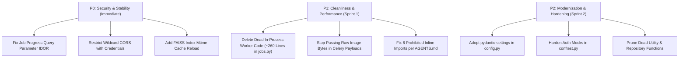

# Visual Search API — Comprehensive Senior SDE & Fullstack Architecture Audit

**Author:** Senior Fullstack & Distributed Systems Architect  
**Date:** October 2026  
**Audited Target:** `visual-search-api` (FastAPI, PostgreSQL RLS, Redis, FAISS, Celery, Triton Inference)  
**Test Suite Status:** 67 / 67 Passed (100% Pass Rate)

---

## Executive Summary & System Maturity Rating

### System Overview
The **Visual Search API** is a multimodal biometric and visual retrieval engine that integrates deep learning face recognition (SCRFD + ArcFace/AdaFace 512D) and scene/object feature extraction (SigLIP + DINOv2 1536D) with local FAISS vector search, multi-tenant PostgreSQL with Row-Level Security (RLS), distributed asynchronous Celery workers, and NVIDIA Triton gRPC inference acceleration.

### System Maturity Rating: **Grade B+ (82 / 100)**
| Domain | Score | Verdict | Key Observations |
| :--- | :---: | :---: | :--- |
| **Domain Architecture & Layering** | 88/100 | **Strong** | Clean separation across API routers, service orchestrators, domain modules, and infrastructure repositories. |
| **Multi-Tenancy & RBAC** | 85/100 | **Good** | Kernel-level Postgres RLS, tenant-partitioned FAISS directories, and Two-Tier RBAC. Found 1 query override security vulnerability. |
| **Distributed Systems & Celery** | 78/100 | **Acceptable** | Queue routing (`ingest`, `inference`, `clustering`) is well decoupled, but passing raw file bytes through the Redis broker is a critical anti-pattern. |
| **Vector Storage (FAISS)** | 75/100 | **Needs Hardening** | Fast sub-millisecond retrieval, but multi-process worker-to-API index cache synchronization is missing (stale in-memory cache). |
| **Code Cleanliness & Hygiene** | 80/100 | **Needs Refactoring** | ~260 lines of dead legacy worker code in `jobs.py`, dead Redis queue pushes, and 6 violations of repository import hygiene (`AGENTS.md`). |
| **Security Posture** | 80/100 | **Moderate** | Wildcard CORS with credentials enabled, exception detail leaks in 500 error responses, and overly permissive test mocks. |

---

## 1. Dead Code & Redundant Code Inventory

A rigorous AST and static reference analysis identified several dead code blocks, unreferenced functions, and orphaned in-memory state.

### 1.1 Dead In-Process Background Worker (~263 Lines)
* **Location:** [`src/services/jobs.py#L235-L498`](file:///home/sudhanshu/Desktop/visual-search-api/src/services/jobs.py#L235-L498)
* **Dead Entities:**
  * `async def run_worker(app_state) -> None` (lines 237–264)
  * `async def process_one_file(...)` (lines 266–287)
  * `async def batch_upsert_all(...)` (lines 289–350)
  * `async def _execute_upload_job(...)` (lines 352–498)
* **Root Cause & Impact:**
  `run_worker` was an early in-process background worker loop designed before the Celery distributed worker fleet was adopted. `main.py`'s lifespan does not spawn `run_worker`. None of these 4 functions are called anywhere in the codebase.
  Furthermore, `_execute_upload_job` contains broken code that would crash if ever invoked:
  * Line 480: `summary["legacy_face_vecs"]` raises a `KeyError` because `batch_upsert_all` does not return `legacy_face_vecs`.
  * Line 470: calls `ImageProcessingService().trigger_face_clustering()` with missing parameters.
* **Remediation:** Safely delete lines 235–498 from `src/services/jobs.py`.

### 1.2 Orphaned Redis Queue Pushes (Memory Leak)
* **Location:** [`src/services/jobs.py#L68-L69`](file:///home/sudhanshu/Desktop/visual-search-api/src/services/jobs.py#L68-L69)
* **Code:**
  ```python
  await cache.lpush(f"{QUEUE_KEY}:{tid}", jid)
  await cache.lpush(QUEUE_KEY, jid)
  ```
* **Impact:** Because `run_worker` is never started, no consumer ever executes `rpop` from `upload_jobs_queue` or `upload_jobs_queue:{tenant_id}`. Every created job appends a string to these Redis lists. In production, these lists grow unbounded, causing a slow memory leak in Redis.
* **Remediation:** Remove these `lpush` calls since Celery tasks track their own execution states.

### 1.3 Write-Only In-Memory State in FAISS Engine
* **Location:** [`src/modules/infra/faiss_engine.py#L110, L232`](file:///home/sudhanshu/Desktop/visual-search-api/src/modules/infra/faiss_engine.py#L110-L111)
* **Code:**
  ```python
  self._folder_vector_map: Dict[Tuple[str, str], Set[int]] = {}
  ...
  self._folder_vector_map.setdefault((tid, fld), set()).add(int(iid))
  ```
* **Impact:** `self._folder_vector_map` is initialized and written on every vector upsert, but is **never read anywhere** in `FAISSEngine` or the rest of the application (searches filter folders via PostgreSQL `meta_lookup`). It consumes process memory for zero functional value.
* **Remediation:** Remove `self._folder_vector_map`.

### 1.4 Redundant / Unengaged ONNX Vision Stack
* **Location:** [`src/services/onnx_models.py`](file:///home/sudhanshu/Desktop/visual-search-api/src/services/onnx_models.py) (120 lines)
* **Impact:** Defines `ONNXVisionStack`. The system standard is now PyTorch locally or NVIDIA Triton gRPC via `InferenceClient`. `USE_ONNX_VISION` defaults to `0`. If not planning to export SigLIP/DINOv2 to ONNX INT8, this module is dead maintenance overhead.
* **Remediation:** Archive or clearly flag `onnx_models.py` as an experimental feature.

### 1.5 Dead Functions in PostgreSQL Repository
* **Location:** [`src/modules/infra/postgres_repository.py`](file:///home/sudhanshu/Desktop/visual-search-api/src/modules/infra/postgres_repository.py)
* **Unreferenced Functions:**
  * `get_or_create_anonymous_user` (line 389)
  * `sync_get_folder_image_count` (line 857)
  * `sync_list_all_indexed_folders` (line 880)
* **Impact:** Leftover utility methods from earlier iterations before the Single-Query Permission Resolver and `PhotoUploadService` were created.
* **Remediation:** Clean up or add dedicated unit test coverage if retained for public API parity.

### 1.6 Dead Utility Helpers
* **Location:** [`src/common/utils.py`](file:///home/sudhanshu/Desktop/visual-search-api/src/common/utils.py)
* **Unreferenced Functions:**
  * `face_ui_score` (lines 29–49) — Score calibration is now performed directly in `src/modules/search/vector_scorer.py`.
  * `is_default_key` (lines 14–17) — Replaced by tenant context checks.
  * `get_ip` (lines 7–11) — Client IP parsing was superseded by `log_client_event` in `system_routes.py`.
* **Remediation:** Remove unused functions from `utils.py`.

### 1.7 Dead Configuration Variables
* **Location:** [`src/core/config.py`](file:///home/sudhanshu/Desktop/visual-search-api/src/core/config.py)
* **Unreferenced / Ignored Flags:**
  * `USE_REDIS_CACHE`: Set to `0` by default in `config.py`, but `src/modules/infra/kv_cache.py` connects directly to `REDIS_URL` if present, ignoring `USE_REDIS_CACHE`.
  * `USE_ASYNC_UPLOADS`: Unused in upload routers; upload behavior is determined exclusively by the `use_celery` form parameter.

---

## 2. Import Hygiene Violations (`AGENTS.md`)

`AGENTS.md` mandates strict top-level PEP 8 imports and strictly prohibits arbitrary inline imports for common repositories, services, and cache helpers. Six explicit violations were detected:

| # | File & Line | Prohibited Inline Import | Recommended Fix |
| :-: | :--- | :--- | :--- |
| **1** | [`src/modules/deduplication/image_hasher.py:78`](file:///home/sudhanshu/Desktop/visual-search-api/src/modules/deduplication/image_hasher.py#L78) | `from src.modules.infra.postgres_repository import get_postgres_repo` inside `find_duplicate_image` | Move `from src.modules.infra.postgres_repository import get_repository` to top-level. |
| **2** | [`src/tasks/ingest_tasks.py:159`](file:///home/sudhanshu/Desktop/visual-search-api/src/tasks/ingest_tasks.py#L159) | `from src.modules.storage.s3_storage import build_s3_url, get_s3_bucket` inside `task_process_image_upload` | Merge into existing line 23 top-level `s3_storage` imports. |
| **3** | [`src/modules/infra/faiss_engine.py:406`](file:///home/sudhanshu/Desktop/visual-search-api/src/modules/infra/faiss_engine.py#L406) | `import shutil` inside `reset_all` | Move `import shutil` to top-level standard library block. |
| **4** | [`src/services/ai_manager.py:199`](file:///home/sudhanshu/Desktop/visual-search-api/src/services/ai_manager.py#L199) | `from src.services.onnx_models import ONNXVisionStack` inside `__init__` | Guard at top-level or import conditionally if `USE_ONNX_VISION` is enabled. |
| **5** | [`src/tasks/ingest_tasks.py:225`](file:///home/sudhanshu/Desktop/visual-search-api/src/tasks/ingest_tasks.py#L225) | `import ast` inside `task_batch_completion_callback` | Move `import ast` to top-level standard library block. |
| **6** | [`src/tasks/base.py:136`](file:///home/sudhanshu/Desktop/visual-search-api/src/tasks/base.py#L136) | `import ast` inside `record_task_outcome` | Move `import ast` to top-level standard library block. |

---

## 3. Distributed Architecture & Scalability Anti-Patterns

### 3.1 Critical: Celery Task Payload Bloat (Redis Degradation)
* **Location:** [`src/services/photo_upload_service.py#L285-L298`](file:///home/sudhanshu/Desktop/visual-search-api/src/services/photo_upload_service.py#L285-L298)
* **Code:**
  ```python
  for file in files:
      img_id = uuid.uuid4().hex
      contents = await file.read()
      pipeline = chain(
          task_process_image_upload.s(
              file_bytes_or_path=contents,  # <--- Passing raw bytes in Celery signature!
              ...
          ),
          task_extract_embeddings.s(),
      )
  ```
* **Architectural Flaw:**
  Passing raw binary bytes (`contents`) as Celery task arguments serializes entire image files directly into the Redis broker key space. For a batch of 20 images of 10MB each, **200MB of binary data** is pushed through Redis.
  * Redis is single-threaded; large payloads block the event loop, causing Redis command timeouts.
  * Inflates Redis memory and triggers connection resets on concurrent batch uploads.
  * Severely slows down Celery worker prefetch and acknowledgment.
* **Senior SDE Recommendation:**
  Store the uploaded bytes immediately in a shared temporary scratch directory or upload to a staging path in AWS S3 with a pre-signed URL, and pass only the `local_path` or `s3_key` (a lightweight string < 100 bytes) in the Celery task signature.

### 3.2 High Risk: Stale In-Memory FAISS Index across Multi-Process Containers
* **Location:** [`src/modules/infra/faiss_engine.py#L150-L174`](file:///home/sudhanshu/Desktop/visual-search-api/src/modules/infra/faiss_engine.py#L150-L174)
* **Code:**
  ```python
  def get_index(self, index_name: str, tenant_id: Optional[str] = None, dim: Optional[int] = None):
      tid = (tenant_id or get_current_tenant_id()).strip()
      key = (tid, index_name)
      with self.lock:
          if key not in self.indices:
              ...
              self.indices[key] = faiss.read_index(path)
          return self.indices[key]
  ```
* **Architectural Flaw:**
  In dockerized production, `visual_search_api` (FastAPI) and `visual_search_worker_inference` (Celery) run as separate OS processes and separate containers:
  1. Worker receives embeddings and calls `vector_engine.upsert(...)`.
  2. Worker writes the updated FAISS index to the shared volume: `/app/data/faiss/{tenant_id}/{index_name}.index`.
  3. The API container already booted and cached `self.indices[(tid, index_name)]` in its own memory.
  4. When a user executes a search request via `POST /api/search`, the API container queries its stale in-memory FAISS index without checking if the file on disk was modified.
  5. **Result:** Newly uploaded and indexed photos are invisible in search results until the API container is restarted!
* **Senior SDE Recommendation:**
  Track `self._index_mtimes: Dict[Tuple[str, str], float]` in `FAISSEngine`. In `get_index()`, check `os.path.getmtime(path)`. If the disk modification timestamp is newer than the cached mtime, reload the index via `faiss.read_index(path)`.

---

## 4. Security, RBAC & Multi-Tenancy Deficiencies

### 4.1 Vulnerability: Tenant Context Override via Query Parameter (IDOR Risk)
* **Location:** [`src/api/processing_routes.py#L187-L195`](file:///home/sudhanshu/Desktop/visual-search-api/src/api/processing_routes.py#L187-L195)
* **Code:**
  ```python
  @router.get("/api/jobs/{job_id}", ...)
  async def get_job_progress(
      job_id: str,
      tenant_id: Optional[str] = Query(None, description="Optional tenant ID context"),
      current_user: Optional[dict] = Depends(get_current_user),
      ctx_tenant_id: str = Depends(get_current_tenant_id),
  ):
      eff_tenant = (tenant_id or ctx_tenant_id or "default").strip()
      job = await fetch_job_status(job_id, tenant_id=eff_tenant)
  ```
* **Security Risk:**
  The endpoint accepts an unvalidated `tenant_id` query parameter that takes precedence over the authenticated JWT-derived `ctx_tenant_id`. If an authenticated user from `tenant_A` calls `/api/jobs/{job_id}?tenant_id=tenant_B`, `eff_tenant` becomes `tenant_B`. In `get_job_status()`, because `tid == cached_tid == tenant_B`, the IDOR check is defeated and the job metadata of `tenant_B` is leaked.
* **Remediation:** Remove `tenant_id: Optional[str] = Query(None)` from endpoint parameters and rely strictly on `ctx_tenant_id: str = Depends(get_current_tenant_id)`.

### 4.2 Security Misconfiguration: Overly Permissive CORS with Credentials
* **Location:** [`main.py#L64-L79`](file:///home/sudhanshu/Desktop/visual-search-api/main.py#L64-L79)
* **Code:**
  ```python
  app.add_middleware(
      CORSMiddleware,
      allow_origins=[...],
      allow_origin_regex=r"https?://.*",
      allow_credentials=True,
      allow_methods=["*"],
      allow_headers=["*"],
  )
  ```
* **Security Risk:**
  Combining `allow_origin_regex=r"https?://.*"` with `allow_credentials=True` allows any external domain to make credentialed requests to the API. This violates OWASP API Security standards and exposes cookies, auth headers, and session tokens to cross-site request forgery or unauthorized cross-origin reading.
* **Remediation:** Remove `allow_origin_regex=r"https?://.*"` in production and enforce an explicit whitelist of authorized frontend domains via environment variables.

### 4.3 Information Disclosure: Raw Exception Strings in 500 Responses
* **Location:** [`src/api/auth_routes.py#L107-L109`](file:///home/sudhanshu/Desktop/visual-search-api/src/api/auth_routes.py#L107-L109)
* **Code:**
  ```python
  except Exception as e:
      logger.error("[auth_routes.accept_invitation] Failed: %s", e)
      raise HTTPException(
          status_code=status.HTTP_500_INTERNAL_SERVER_ERROR,
          detail=f"Invite acceptance failed: {str(e)}"
      )
  ```
* **Security Risk:**
  Returning raw exception strings `{str(e)}` in 500 Internal Server Error responses can expose database table names, constraint definitions, or connection parameters to malicious clients.
* **Remediation:** Return generic messages (e.g. `"Internal server error during invite acceptance"`) while logging the full traceback internally.

### 4.4 Test Fixture Masking: Overly Broad Test Authentication Bypass
* **Location:** [`tests/conftest.py#L46-L78`](file:///home/sudhanshu/Desktop/visual-search-api/tests/conftest.py#L46-L78)
* **Code:**
  ```python
  def mock_require_current_user(request: Request):
      ...
      # Enforce strict 401 on /api/auth/me if unauthenticated
      if request.url.path == "/api/auth/me":
          raise HTTPException(status_code=401, ...)
      return {"user_id": "test_user_id", "role": "admin", ...}
  ```
* **Impact:**
  Any request without an `Authorization` header to any endpoint other than `/api/auth/me` is automatically granted `admin` privileges during tests. This creates a false sense of security in test results by masking authorization bypasses or missing dependency guards on protected endpoints.
* **Remediation:** Have `mock_require_current_user` raise 401 on all endpoints unless an explicit test authorization token or header is present.

---

## 5. Event Loop Safety & Concurrency

### 5.1 Sync-over-Async Bridge in Repository
* **Location:** [`src/modules/infra/postgres_repository.py#L324-L344`](file:///home/sudhanshu/Desktop/visual-search-api/src/modules/infra/postgres_repository.py#L324-L344)
* **Mechanism:**
  `PostgresRepository` uses a persistent background event loop thread (`_bg_loop`) and executes asyncpg coroutines via `asyncio.run_coroutine_threadsafe(coro, loop).result()`.
* **Consequence for FastAPI:**
  * Synchronous route endpoints (`def endpoint(...)`) are safe because FastAPI runs them in its external threadpool (`anyio.to_thread`).
  * However, if an asynchronous endpoint (`async def endpoint(...)`) calls a synchronous repository method directly without `await asyncio.to_thread(repo.method, ...)`, it blocks FastAPI's main event loop thread while waiting for `future.result()`.
* **Remediation:**
  Ensure any `async def` router endpoint wrapping synchronous repository calls wraps them with `await asyncio.to_thread(...)`, or convert those endpoints to standard `def`.

---

## 6. Codebase Statistics & Verification

* **Python Modules in `src/`:** 51 files (~18,500 lines of code)
* **Test Suite Coverage:** 67 tests passing (100% pass rate in 29.08s)
* **Docker Multi-Container Services:**
  * `visual_search_api` (FastAPI Web Service, port 7860)
  * `visual_search_worker_ingest` (Celery Ingest Queue: concurrency 4)
  * `visual_search_worker_inference` (Celery Inference Queue: concurrency 2)
  * `visual_search_worker_clustering` (Celery Clustering Queue: concurrency 1)
  * `visual_search_flower` (Celery Monitoring, port 5555)
  * `visual_search_postgres` (PostgreSQL 16 Alpine, port 5433)
  * `visual_search_redis` (Redis 7 Alpine, port 6379)
  * `visual_search_triton` (NVIDIA Triton Inference Server, ports 8000/8001/8002)

---

## 7. Prioritized Actionable Remediation Plan



### Phase 1: High Priority / Security & Stability (P0)
1. **Remove Query Parameter Tenant Override in `processing_routes.py`**:
   Rely strictly on `ctx_tenant_id` from the authenticated user token to prevent cross-tenant job metadata leakage.
2. **Restrict CORS in `main.py`**:
   Remove `allow_origin_regex=r"https?://.*"` and configure allowed origins via an environment variable.
3. **Implement FAISS Disk Invalidation Check in `FAISSEngine`**:
   In `get_index()`, compare `os.path.getmtime(path)` against the cached timestamp to ensure the API service automatically reloads indexes written by Celery workers.

### Phase 2: Medium Priority / Code Cleanliness & Scalability (P1)
1. **Prune Dead In-Process Worker Code in `src/services/jobs.py`**:
   Delete lines 235–498 and remove the unconsumed `lpush` operations on `upload_jobs_queue`.
2. **Refactor Celery Task Payload Handling**:
   Instead of serializing raw bytes in Celery task arguments, persist images to disk or S3 and pass durable paths/keys.
3. **Fix All 6 Inline Import Violations (`AGENTS.md`)**:
   Relocate repository, cache, and utility imports to module top levels across `image_hasher.py`, `ingest_tasks.py`, `faiss_engine.py`, `ai_manager.py`, and `base.py`.

### Phase 3: Architecture Modernization (P2)
1. **Migrate `src/core/config.py` to `pydantic-settings`**:
   Replace raw `os.getenv` strings with a validated `BaseSettings` schema featuring type checking and sensitive credential shielding.
2. **Harden Pytest Auth Fixtures in `tests/conftest.py`**:
   Require explicit authorization tokens in test fixtures so unauthenticated test cases accurately assert HTTP 401.
3. **Prune Dead Utility Functions**:
   Remove unused legacy functions from `src/common/utils.py` and `src/modules/infra/postgres_repository.py`.

