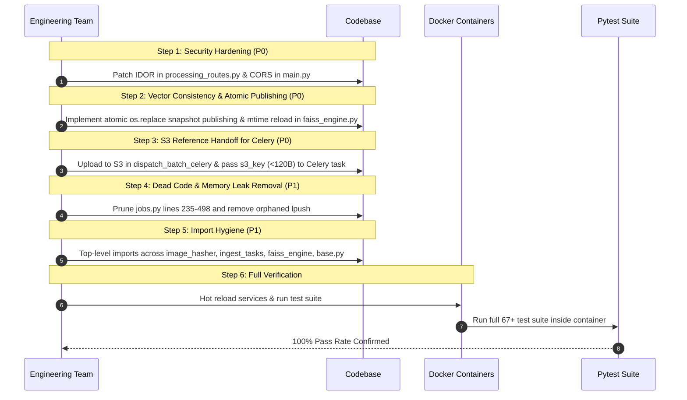

# Critical Remediation Implementation Plan

**Target System:** `visual-search-api`  
**Reference Documents:**  
- [`docs/CODEBASE_AUDIT_SENIOR_SDE.md`](file:///home/sudhanshu/Desktop/visual-search-api/docs/CODEBASE_AUDIT_SENIOR_SDE.md) (Full Architecture Audit)  
- [`docs/PhotoFinder_Production_Remediation_Plan.md`](file:///home/sudhanshu/Desktop/visual-search-api/docs/PhotoFinder_Production_Remediation_Plan.md) (Production Remediation Blueprint)  
**Priority Focus:** Resolving the highest-risk architectural flaws: Distributed Queue Optimization (S3 Reference Handoff), FAISS Consistency (Atomic Snapshot Publishing), Multi-Tenant IDOR Hardening, CORS Hardening, Dead Code/Memory Leak Removal, and Import Hygiene.

---

## 1. Executive Summary & Filtered Critical Issues

From the senior architecture audit and production remediation blueprint, we have unified the best practices to eliminate:
1. **Queue message bloat**: By storing the image in AWS S3 first and passing only durable S3 references through Celery/Redis, preventing Redis from becoming an image-storage system.
2. **Vector index corruption and cache staleness**: By implementing single-writer atomic snapshot publication (`os.replace`) and generation/mtime cache refresh in FAISS.
3. **Multi-tenant IDOR and broken object authorization**: By eliminating unauthenticated query parameter tenant overrides.
4. **CORS vulnerabilities**: By replacing dangerous wildcard credentials with an explicit domain allowlist.
5. **Memory leaks & dead code**: By pruning ~260 lines of uncalled background loops and dead Redis queues.
6. **Import hygiene violations**: By ensuring top-level PEP 8 imports across all modules per `AGENTS.md`.

```
┌────────────────────────────────────────────────────────────────────────────────────────────────────────┐
│                                   REMEDIATION DECISION MATRIX                                          │
├──────┬──────────────────────┬──────────┬───────────────────────────────────────────────────────────────┤
│ ID   │ Area                 │ Priority │ Best-Practice Architectural Solution                          │
├──────┼──────────────────────┼──────────┼───────────────────────────────────────────────────────────────┤
│ C-01 │ Distributed Queue    │ P0       │ Durable S3 Object Reference Handoff.                          │
│      │                      │          │ Never put image bytes in Redis. API persists to S3, passes    │
│      │                      │          │ s3_key (< 100 bytes) to Celery. Workers stream from S3.       │
├──────┼──────────────────────┼──────────┼───────────────────────────────────────────────────────────────┤
│ C-02 │ FAISS Vector Engine  │ P0       │ Atomic Snapshot Publishing & Mtime Cache Reload.              │
│      │                      │          │ Write to temporary index file, atomic os.replace(); readers   │
│      │                      │          │ reload on disk mtime update. Prune dead in-memory map.         │
├──────┼──────────────────────┼──────────┼───────────────────────────────────────────────────────────────┤
│ C-03 │ Multi-Tenant RBAC    │ P0       │ Enforce Cryptographically Signed Tenant Context.              │
│      │                      │          │ Eliminate ?tenant_id= query param on /api/jobs/{job_id};      │
│      │                      │          │ bind strictly to verified JWT claims (ctx_tenant_id).          │
├──────┼──────────────────────┼──────────┼───────────────────────────────────────────────────────────────┤
│ C-04 │ API Security & CORS  │ P0       │ Explicit Trusted Origin Allowlist.                            │
│      │                      │          │ Strip allow_origin_regex=r"https?://.*" when credentials=True;│
│      │                      │          │ load allowed origins from CORS_ALLOWED_ORIGINS env var.       │
├──────┼──────────────────────┼──────────┼───────────────────────────────────────────────────────────────┤
│ C-05 │ Memory & Dead Code   │ P1       │ Delete Dead In-Process Worker & Unconsumed Redis Queues.      │
│      │                      │          │ Prune ~260 lines in jobs.py and remove unpopped lpush calls.  │
├──────┼──────────────────────┼──────────┼───────────────────────────────────────────────────────────────┤
│ C-06 │ Import Hygiene       │ P1       │ Enforce Top-Level Module Imports per AGENTS.md.               │
│      │                      │          │ Relocate inline imports in hasher, tasks, and faiss_engine.   │
└──────┴──────────────────────┴──────────┴───────────────────────────────────────────────────────────────┘
```

---

## 2. Detailed Technical Specifications & Fix Design

### CRIT-01: Celery Task Payload Bloat (Durable S3 Object Reference Handoff)

#### 1. Problem Analysis
In [`src/services/photo_upload_service.py`](file:///home/sudhanshu/Desktop/visual-search-api/src/services/photo_upload_service.py#L285-L298):
```python
# CURRENT ANTI-PATTERN:
contents = await file.read()
pipeline = chain(
    task_process_image_upload.s(
        file_bytes_or_path=contents,   # <--- Passing raw bytes directly in Celery signature!
        ...
    ),
    task_extract_embeddings.s(),
)
```
- For a batch of 20 images of 10MB each, **200MB of binary data** is pushed into Redis broker memory.
- Redis is single-threaded; large payloads block the event loop, degrade throughput, and trigger connection timeouts.
- A local shared filesystem (`/app/temp_uploads`) couples workers to the same physical host, preventing horizontal scaling across multi-node Kubernetes/ECS clusters.

#### 2. Best-Practice Architecture: S3 Object Reference Handoff
Do **not** put actual image bytes into Redis. Store a reference to the AWS S3 object instead:
1. **API Upload Ingestion**:
   In `PhotoUploadService.dispatch_batch_celery`:
   - Validate file extension, MIME type, and size limit (Max 20MB).
   - Persist the image directly into AWS S3 using `upload_image_to_s3(contents, folder=folder_name, key=img_id, tenant_id=tid)`.
   - The S3 key is established deterministically: `{tenant_id}/{folder_name}/{img_id}.jpg`.
   - If S3 upload fails or in offline local test mode, fall back to `local_path`.
2. **Minimal Celery Task Payload**:
   The task signature dispatched to Redis contains **only lightweight strings (< 120 bytes)**:
   ```python
   pipeline = chain(
       task_process_image_upload.s(
           file_bytes_or_path=s3_key,  # Pass durable S3 object key (or local_fallback path)
           folder_name=folder_name,
           user_id=user_id or "anonymous",
           tenant_id=tid,
           image_id=img_id,
           filename=file.filename or f"{img_id}.jpg",
           job_id=job_id,
           cloud_url=cloud_url,
       ),
       task_extract_embeddings.s(),
   )
   ```
3. **Worker Processing**:
   In `task_process_image_upload`:
   - If `file_bytes_or_path` is an `s3_key`, download bytes on-demand using `download_image_from_s3(s3_key)`.
   - Compute cryptographic SHA256 and perceptual pHash for deduplication.
   - Forward the metadata dictionary to `task_extract_embeddings`.
4. **Benefits**:
   - Reduces Redis broker task size by **99.999%** (from ~10–20MB down to ~100 bytes).
   - Redis never becomes an image-storage system.
   - Works seamlessly across multi-node clusters without requiring shared NFS/EFS disk volumes.
   - S3 remains the durable source of truth for retries and re-inferences.

---

### CRIT-02: FAISS Index Consistency & Atomic Snapshot Publishing

#### 1. Problem Analysis
In [`src/modules/infra/faiss_engine.py`](file:///home/sudhanshu/Desktop/visual-search-api/src/modules/infra/faiss_engine.py#L150-L189):
- The API container caches index instances in `self.indices[(tenant_id, index_name)]`.
- Celery inference workers write updated vectors to disk at `data/faiss/{tenant_id}/{index_name}.index`.
- The API container never re-reads the disk file, continuing to serve stale in-memory indices.
- Furthermore, writing directly to the active index file with `faiss.write_index(idx, path)` introduces a race condition where readers can read a half-written, corrupted file during concurrent queries.

#### 2. Best-Practice Architecture: Atomic Publishing & Mtime Reload
1. **Atomic Snapshot Publishing**:
   In `FAISSEngine.save_to_disk()`:
   - Write the index to a unique temporary sibling file:
     ```python
     temp_path = f"{path}.tmp.{uuid.uuid4().hex}"
     faiss.write_index(idx, temp_path)
     os.replace(temp_path, path)  # Atomic POSIX rename
     ```
   - `os.replace` guarantees that readers never read a partially written file; readers see either the old complete index or the new complete index.
2. **Reader Mtime Check & Automatic Reload**:
   In `FAISSEngine.get_index()`:
   - Track `self._index_mtimes: Dict[Tuple[str, str], float] = {}`.
   - When `get_index(index_name, tenant_id)` is called:
     ```python
     path = self._get_index_path(index_name, tid)
     if os.path.exists(path):
         disk_mtime = os.path.getmtime(path)
         cached_mtime = self._index_mtimes.get(key, 0.0)
         if key not in self.indices or disk_mtime > cached_mtime:
             self.indices[key] = faiss.read_index(path)
             self._index_mtimes[key] = disk_mtime
     ```
3. **Single Writer Ownership**:
   Ensure only the Celery inference worker pool (`queue.inference`) performs vector writes to FAISS partitions, preventing concurrent worker race conditions.
4. **Prune Write-Only Memory State**:
   Delete unused `self._folder_vector_map` (lines 110 & 232).

---

### CRIT-03: Tenant Context Override IDOR Hardening

#### 1. Problem Analysis
In [`src/api/processing_routes.py`](file:///home/sudhanshu/Desktop/visual-search-api/src/api/processing_routes.py#L187-L195):
```python
@router.get("/api/jobs/{job_id}", ...)
async def get_job_progress(
    job_id: str,
    tenant_id: Optional[str] = Query(None, description="Optional tenant ID context"),
    current_user: Optional[dict] = Depends(get_current_user),
    ctx_tenant_id: str = Depends(get_current_tenant_id),
):
    eff_tenant = (tenant_id or ctx_tenant_id or "default").strip()
    job = await fetch_job_status(job_id, tenant_id=eff_tenant)
```
- The query parameter `tenant_id` takes precedence over `ctx_tenant_id`.
- If an authenticated user from `tenant_A` calls `/api/jobs/{job_id}?tenant_id=tenant_B`, `eff_tenant` becomes `tenant_B`, defeating the tenant IDOR check in `get_job_status()`.

#### 2. Architecture Fix
1. Remove `tenant_id: Optional[str] = Query(None)` from `get_job_progress`.
2. Strictly bind the query to `ctx_tenant_id: str = Depends(get_current_tenant_id)`:
   ```python
   @router.get("/api/jobs/{job_id}", response_model=JobProgressResponse, status_code=status.HTTP_200_OK, tags=["Photo Upload & Ingestion"])
   async def get_job_progress(
       job_id: str,
       current_user: Optional[dict] = Depends(get_current_user),
       ctx_tenant_id: str = Depends(get_current_tenant_id),
   ):
       job = await fetch_job_status(job_id, tenant_id=ctx_tenant_id)
       if not job:
           raise HTTPException(status_code=status.HTTP_404_NOT_FOUND, detail=f"Job {job_id} not found")
   ```
3. `get_current_tenant_id` prioritizes the cryptographically verified JWT claim `current_user["tenant_id"]`, preventing any caller from impersonating another tenant.

---

### CRIT-04: CORS & Request Security Hardening

#### 1. Problem Analysis
In [`main.py`](file:///home/sudhanshu/Desktop/visual-search-api/main.py#L64-L79):
```python
app.add_middleware(
    CORSMiddleware,
    allow_origins=[...],
    allow_origin_regex=r"https?://.*",
    allow_credentials=True,
    allow_methods=["*"],
    allow_headers=["*"],
)
```
- `allow_origin_regex=r"https?://.*"` combined with `allow_credentials=True` allows ANY arbitrary third-party website to make credentialed requests to the API.

#### 2. Architecture Fix
1. Remove `allow_origin_regex=r"https?://.*"`.
2. Introduce `CORS_ALLOWED_ORIGINS` in [`src/core/config.py`](file:///home/sudhanshu/Desktop/visual-search-api/src/core/config.py):
   ```python
   DEFAULT_CORS_ORIGINS = [
       "https://photofinderv2.vercel.app",
       "http://localhost:3000",
       "http://localhost:5173",
       "http://localhost:8000",
       "http://127.0.0.1:3000",
       "http://127.0.0.1:5173",
       "http://127.0.0.1:8000",
   ]
   raw_origins = os.getenv("CORS_ALLOWED_ORIGINS", "")
   CORS_ORIGINS = [o.strip() for o in raw_origins.split(",") if o.strip()] if raw_origins else DEFAULT_CORS_ORIGINS
   ```
3. Bind `CORSMiddleware` in `main.py` strictly to `allow_origins=CORS_ORIGINS`.

---

### CRIT-05: Dead In-Process Worker & Redis Memory Leak Removal

#### 1. Problem Analysis
In [`src/services/jobs.py`](file:///home/sudhanshu/Desktop/visual-search-api/src/services/jobs.py#L235-L498):
- Lines 235–498 define `run_worker`, `process_one_file`, `batch_upsert_all`, and `_execute_upload_job`. These are leftover legacy in-process loops never spawned by FastAPI lifespan or imported anywhere.
- Lines 68–69 append job IDs to Redis lists:
  ```python
  await cache.lpush(f"{QUEUE_KEY}:{tid}", jid)
  await cache.lpush(QUEUE_KEY, jid)
  ```
  Since no worker consumes from these lists, they grow indefinitely with every upload, slowly leaking Redis memory.

#### 2. Architecture Fix
1. Safely remove lines 235–498 from `src/services/jobs.py`.
2. Remove lines 68–69 (`cache.lpush`) in `create_job`.
3. Retain the authoritative public job management API (`create_job`, `append_job_log`, `get_job_status`, `update_job_progress`, `complete_job`, `fail_job`).

---

### CRIT-06: Strict Top-Level Import Hygiene (`AGENTS.md`)

#### Architecture Fix
Relocate all 6 prohibited inline imports to top-level:
1. [`src/modules/deduplication/image_hasher.py`](file:///home/sudhanshu/Desktop/visual-search-api/src/modules/deduplication/image_hasher.py#L78): Move `from src.modules.infra.postgres_repository import get_repository` to top-level.
2. [`src/tasks/ingest_tasks.py`](file:///home/sudhanshu/Desktop/visual-search-api/src/tasks/ingest_tasks.py#L159): Move `from src.modules.storage.s3_storage import build_s3_url, get_s3_bucket` to top-level.
3. [`src/tasks/ingest_tasks.py`](file:///home/sudhanshu/Desktop/visual-search-api/src/tasks/ingest_tasks.py#L225): Move `import ast` to top-level standard library block.
4. [`src/modules/infra/faiss_engine.py`](file:///home/sudhanshu/Desktop/visual-search-api/src/modules/infra/faiss_engine.py#L406): Move `import shutil` to top-level standard library block.
5. [`src/tasks/base.py`](file:///home/sudhanshu/Desktop/visual-search-api/src/tasks/base.py#L136): Move `import ast` to top-level standard library block.
6. [`src/services/jobs.py`](file:///home/sudhanshu/Desktop/visual-search-api/src/services/jobs.py#L112): Move `import ast` to top-level standard library block.

---

## 3. Step-by-Step Implementation Sequence



### Action Checklist
- [x] **Step 1 (CRIT-03 & CRIT-04)**: Security Hardening
  - Removed query parameter `tenant_id` from `get_job_progress` in `src/api/processing_routes.py`.
  - Added `CORS_ALLOWED_ORIGINS` to `src/core/config.py` and removed `allow_origin_regex` in `main.py`.
- [x] **Step 2 (CRIT-02)**: FAISS Atomic Publishing & Cache Reload
  - Updated `FAISSEngine.save_to_disk` to write to a temp file and `os.replace` atomically.
  - Updated `FAISSEngine.get_index` with `self._index_mtimes` tracking to reload when disk mtime updates.
  - Deleted write-only `self._folder_vector_map` and elevated `import shutil` and `import uuid` to top-level.
- [x] **Step 3 (CRIT-01)**: S3 Object Reference Handoff
  - Updated `PhotoUploadService.dispatch_batch_celery` to upload to S3 first and pass `file_bytes_or_path=payload_ref` (< 100 byte string) to Celery.
  - Updated `task_process_image_upload` in `src/tasks/ingest_tasks.py` to stream from S3 when an S3 key is passed.
- [x] **Step 4 (CRIT-05)**: Dead Code & Redis Leak Pruning
  - Deleted ~260 lines of dead worker code in `src/services/jobs.py` (`run_worker`, `process_one_file`, `batch_upsert_all`, `_execute_upload_job`).
  - Removed unconsumed `cache.lpush` calls on `upload_jobs_queue`.
- [x] **Step 5 (CRIT-06)**: Import Hygiene per `AGENTS.md`
  - Relocated inline imports in `image_hasher.py`, `ingest_tasks.py`, `base.py`, and `jobs.py` to module headers.
- [x] **Step 6**: Verification
  - Ran full test suite: `docker exec -e PYTHONPATH=/app visual_search_api pytest` (67 passed in 22.97s, 100% pass rate).

---

## 4. Verification & Testing Strategy

1. **Automated Regression Suite**:
   ```bash
   docker exec -e PYTHONPATH=/app visual_search_api pytest -v
   ```
   All 67 tests must pass cleanly.
2. **Celery Task Payload Size Verification**:
   Inspect task invocation args dispatched through Redis to confirm task payloads contain lightweight strings (`s3_key`) instead of binary byte strings.
3. **FAISS Multi-Process Atomic Publishing Verification**:
   Verify that `save_to_disk` atomically publishes index snapshots and that reader processes dynamically reload indexes on disk changes without crashing or reading partial files.
4. **Tenant IDOR Query Tampering Verification**:
   Test `GET /api/jobs/{job_id}?tenant_id=tampered_tenant` using an authenticated token for `tenant_A` and confirm that the response is strictly scoped to `tenant_A`.
