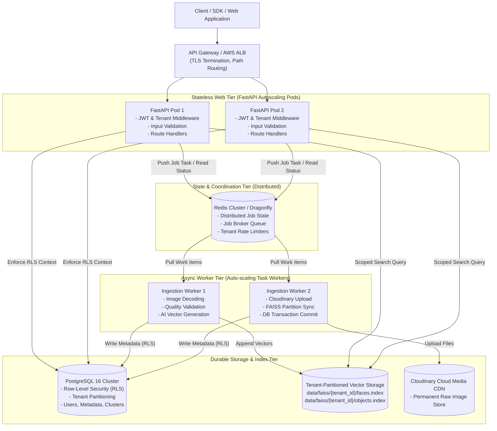
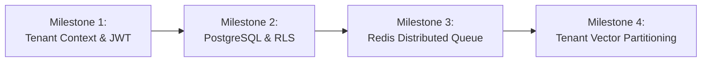

# Phase 1 Implementation Plan: Multi-Tenant Architecture & State Decoupling

This document defines the architectural blueprint, technology rationale, component boundaries, and structural execution plan for **Phase 1** of our journey toward an enterprise-scale Multi-Tenant SaaS platform (as outlined in [`context/07_production_saas_scale_plan.md`](../context/07_production_saas_scale_plan.md)).

---

## 1. Executive Summary & Objective

### 1.1 The Problem with the Current Architecture
The current Visual Search API is built as a **stateful, single-container monolith**:
1. **SQLite Database (`data/local_storage.db`)**: Locks the entire database file on writes. Running multiple container replicas causes fatal `sqlite3.OperationalError: database is locked` exceptions.
2. **In-Memory Job State (`services/jobs.py`)**: Background upload jobs live in a local Python dictionary (`_jobs = {}`). If a user hits a load balancer routed to Replica B, polling returns `404 Job Not Found` because the job only exists in Replica A's memory.
3. **No Hard Tenant Isolation**: Data is separated only by an optional `folder_name` string. There is no strict customer boundary, risking cross-tenant data leakage and IDOR vulnerabilities.
4. **Global FAISS Vector Index**: All faces reside in a single flat vector index (`faces.index`). One tenant's query computes cosine distance against every other tenant's faces.

### 1.2 Phase 1 North Star
> **Phase 1 transforms the API into a 100% Stateless Web Tier with strict Multi-Tenant Isolation (Row-Level Security), durable external state (PostgreSQL + Redis), and isolated vector namespaces.**

At the conclusion of Phase 1, the API containers will hold **zero persistent state**, allowing them to scale horizontally from 1 to 50+ pods behind an AWS Application Load Balancer without data collision or memory loss.

---

## 2. Technology Selection Rationale ("Why What?")

Before deciding *how* to write the code, we must justify *why* each foundational technology is selected.

```
┌────────────────────────────────────────────────────────────────────────┐
│                      TECHNOLOGY DECISION MATRIX                        │
├──────────────────┬─────────────────────────────┬───────────────────────┤
│ Requirement      │ Chosen Technology           │ Rejected Alternative  │
├──────────────────┼─────────────────────────────┼───────────────────────┤
│ Relational Store │ PostgreSQL 16 (Async)       │ SQLite / MongoDB      │
│ Tenant Isolation │ Row-Level Security (RLS)    │ App-level WHERE query │
│ Ephemeral State  │ Redis 7 (or Dragonfly)      │ Local Python Memory   │
│ Job Worker Queue │ Celery / ARQ (Redis broker) │ asyncio.create_task   │
│ Vector Partition │ Tenant-Partitioned FAISS    │ Monolithic FAISS      │
└──────────────────┴─────────────────────────────┴───────────────────────┘
```

### 2.1 Why PostgreSQL 16 (over SQLite or MongoDB)?
- **Concurrency & Multi-Writer**: Unlike SQLite's file-level table locking, PostgreSQL implements Multi-Version Concurrency Control (MVCC) and row-level locking. Hundreds of concurrent ingestion workers can write simultaneously without blocking readers.
- **Connection Pooling**: Supports async connection pooling via `asyncpg` / SQLAlchemy 2.0 with PgBouncer, sustaining thousands of persistent client connections.
- **ACID Reliability & WAL**: Write-Ahead Logging (WAL) ensures point-in-time recovery, zero data corruption on sudden container restarts, and replication to read-replicas for high availability.
- **Relational Integrity for Metadata**: Face bounding boxes, image clusters, user profiles, and indexing states have relational dependencies. A document store (MongoDB) lacks foreign key constraints and requires complex two-phase commits to maintain consistency.

### 2.2 Why Row-Level Security (RLS) (over Application-Level `WHERE tenant_id = ...`)?
- **Defense in Depth**: In application-level filtering, every developer must remember to include `WHERE tenant_id = :tenant_id` on every SQL query, join, and update. If a single query misses this clause, **all customer data leaks to an unauthorized user (catastrophic IDOR breach)**.
- **Kernel-Level Enforcement**: PostgreSQL RLS enforces tenant separation inside the database engine. When the API sets `SET LOCAL app.current_tenant_id = 'tenant-uuid'`, PostgreSQL automatically and invisibly applies the filter to every `SELECT`, `UPDATE`, and `DELETE`. Even if an engineer writes `SELECT * FROM vector_metadata;`, PostgreSQL returns **only** that tenant's records.

### 2.3 Why Redis (over Local In-Memory Dictionaries)?
- **Distributed Shared State**: In a multi-pod cluster, all API instances and asynchronous worker nodes share a single source of truth for:
  - Ephemeral job progress (percentage, current file, error messages).
  - Active JWT blacklists and session revocations.
  - Rate limiting buckets (Token Bucket algorithm per tenant).
- **Sub-Millisecond Latency**: Operating strictly in RAM with $O(1)$ key lookups, Redis prevents the database from being hammered by polling clients (e.g., polling `/api/jobs/{job_id}` every 500ms).
- **Atomic Operations**: Redis primitives (`INCR`, `HSET`, `EXPIRE`, `BLPOP`) guarantee thread-safe, lock-free updates across distributed nodes.

### 2.4 Why Distributed Worker Queues (over `asyncio.create_task` or ThreadPools)?
- **Process Decoupling**: If an image processing task runs via `asyncio.create_task` inside the web container and the container runs out of memory (OOM) or restarts during a deploy, **the job is killed and lost forever**.
- **Independent Autoscaling (KEDA)**: Web requests require CPU/memory for I/O; image preprocessing and embedding require high CPU/GPU. With a distributed queue (Celery or ARQ backed by Redis), web containers can stay at 2 pods while worker containers scale to 20 pods when a 10,000-photo batch arrives.
- **Backpressure & Dead-Letter Queues (DLQ)**: If an external service (like Cloudinary) rate-limits requests, the queue safely holds pending tasks and implements exponential backoff retries without dropping work.

### 2.5 Why Tenant-Partitioned FAISS Indexes (over One Monolithic Index)?
- **Elimination of Cross-Tenant Bleed**: Searching a monolithic index with all customers' faces risks returning an image from Company B to Company A if threshold tuning is slightly off.
- **Search Latency**: Querying a 10,000-vector index for Tenant A takes **< 1ms**, whereas querying a 5,000,000-vector monolithic index takes **35ms+**.
- **Cold Storage Offloading**: Inactive tenants can have their `.index` file flushed to disk or AWS S3 and loaded into RAM only upon demand, conserving server memory.

---

## 3. Architecture & System Boundaries ("Where and What")



### 3.1 State Ownership & Boundaries

| Component | Nature | Storage Location | Durability |
| :--- | :--- | :--- | :--- |
| **HTTP Request Context** | Ephemeral | `Request.state` / `contextvars` | Scope of 1 HTTP Request |
| **Job Progress & Logs** | Semi-Ephemeral | Redis Hash (`job:{tenant_id}:{job_id}`) | TTL: 7 days |
| **User & Tenant Metadata**| Durable | PostgreSQL (`tenants`, `users`, `vector_metadata`) | Permanent (ACID) |
| **Raw Media Files** | Durable | Cloudinary CDN / AWS S3 | Permanent |
| **Vector Indexes** | Durable / Fast Cache | `data/faiss/{tenant_id}/` (Synced to S3) | Persistent per tenant |

---

## 4. Target Code Architecture & Modularity Blueprint

To ensure that the codebase remains maintainable, testable, and loosely coupled as it expands, we adopt **Clean / Hexagonal Architecture (Ports and Adapters)**.

```
       ┌────────────────────────────────────────────────────────┐
       │                       API LAYER                        │
       │     FastAPI Routers, Request Handlers, DTO Schemas     │
       └───────────────────────────┬────────────────────────────┘
                                   │ Calls
                                   ▼
       ┌────────────────────────────────────────────────────────┐
       │                   APPLICATION LAYER                    │
       │    Use Cases, Orchestrators, Application Services      │
       └──────────────┬──────────────────────────┬──────────────┘
                      │ Uses                     │ Uses
                      ▼                          ▼
       ┌────────────────────────┐      ┌────────────────────────┐
       │      DOMAIN LAYER      │      │     PORTS (Abstract)   │
       │  Entities, Value Obj,  │      │  IRepository, IStorage,│
       │  Domain Policies, Math │      │  IVectorEngine, IQueue │
       └────────────────────────┘      └───────────▲────────────┘
                                                   │ Implements
       ┌───────────────────────────────────────────┴────────────┐
       │                  INFRASTRUCTURE LAYER                  │
       │ PostgresRepository, RedisJobQueue, FAISSEngine, S3/CDN │
       └────────────────────────────────────────────────────────┘
```

### 4.1 Dependency Rule
- **Inner layers know nothing about outer layers**:
  - The Domain Layer does **not** import FastAPI, SQLAlchemy, or Redis.
  - The Application Layer depends only on Domain models and abstract Ports (interfaces).
  - The Infrastructure Layer implements those abstract interfaces.
  - Dependencies are injected via FastAPI's `Depends()` dependency injection mechanism.

### 4.2 Proposed Modular Directory Structure

```
src/
├── api/                                 # [API LAYER] Presentation & HTTP Adapters
│   ├── dependencies/                    # Dependency injection providers (DB, Auth, Tenant)
│   │   ├── auth.py                      # Current user / Token decoding
│   │   ├── database.py                  # Async PostgreSQL session provider
│   │   └── tenant.py                    # Tenant context extractor
│   ├── middleware/                      # HTTP Middlewares
│   │   ├── tenant_context.py            # Injects tenant_id into Postgres RLS session
│   │   └── rate_limiter.py              # Redis token-bucket middleware
│   ├── v1/                              # Versioned API Endpoints
│   │   ├── auth_routes.py
│   │   ├── search_routes.py
│   │   ├── upload_routes.py
│   │   ├── cluster_routes.py
│   │   └── job_routes.py
│   └── schemas/                         # Pydantic v2 Request/Response Models
│       ├── auth_schemas.py
│       ├── search_schemas.py
│       └── upload_schemas.py
│
├── application/                         # [APPLICATION LAYER] Business Workflows & Use Cases
│   ├── services/
│   │   ├── search_orchestrator.py       # Coordinates vector search + metadata joining
│   │   ├── ingestion_orchestrator.py    # Coordinates image decode + AI + DB + Vector store
│   │   ├── clustering_service.py        # Coordinates HDBSCAN medoid clustering
│   │   └── job_tracking_service.py      # Reads/writes job progress to Redis
│   └── ports/                           # Abstract Interfaces (Protocol / ABC)
│       ├── i_metadata_repository.py     # Database contract
│       ├── i_vector_repository.py       # FAISS contract
│       ├── i_job_queue.py               # Distributed queue contract
│       └── i_storage_service.py         # Cloud media storage contract
│
├── domain/                              # [DOMAIN LAYER] Pure Business Entities & Rules
│   ├── models/
│   │   ├── tenant.py                    # Tenant aggregate root
│   │   ├── user.py                      # User entity
│   │   ├── face_vector.py               # Vector entity with embedding & bounding box
│   │   └── search_result.py             # Match result entity with fused similarity score
│   ├── exceptions.py                    # Domain-level exceptions (TenantNotFound, etc.)
│   └── math/
│       ├── vector_fusion.py             # ArcFace (0.60) + AdaFace (0.40) fusion math
│       └── quality_scorer.py            # Laplacian blur & luminance calculations
│
├── infrastructure/                      # [INFRASTRUCTURE LAYER] Concrete Tech Implementations
│   ├── database/
│   │   ├── session.py                   # Async SQLAlchemy engine + asyncpg connection pool
│   │   ├── migrations/                  # Alembic migration scripts
│   │   ├── models/                      # SQLAlchemy ORM table declarations
│   │   │   ├── tenant_orm.py
│   │   │   ├── user_orm.py
│   │   │   └── metadata_orm.py
│   │   └── postgres_metadata_repo.py    # Concrete implementation of IMetadataRepository
│   ├── queue/
│   │   ├── redis_client.py              # Redis async connection client
│   │   ├── redis_job_queue.py           # Concrete implementation of IJobQueue
│   │   └── workers/                     # Celery / ARQ worker tasks
│   │       ├── ingestion_worker.py
│   │       └── cluster_worker.py
│   ├── vector/
│   │   └── tenant_faiss_engine.py       # Concrete implementation of IVectorRepository
│   ├── storage/
│   │   └── cloudinary_adapter.py        # Concrete implementation of IStorageService
│   └── vision/                          # AI Model execution (Local in Phase 1, Triton in Phase 3)
│       ├── ai_manager.py
│       └── onnx_runtime.py
│
└── core/                                # Cross-cutting configuration & utilities
    ├── config.py                        # Pydantic BaseSettings (Reads .env)
    ├── logging.py                       # Structured JSON logging
    └── security.py                      # Argon2 password hashing & JWT encoding
```

---

## 5. Phase 1 Step-by-Step Implementation Breakdown

Phase 1 is divided into **4 distinct, sequential architectural milestones**. Each milestone is atomic and can be verified independently before proceeding.



---

### Milestone 1: Multi-Tenant Context & JWT Claims
*Objective: Guarantee every request carries an authenticated, tamper-proof `tenant_id`.*

1. **Schema & Token Enhancements**:
   - Update `User` entity to belong to a `Tenant` (`tenant_id: UUID`).
   - Include `tenant_id` inside the JWT payload:
     ```json
     {
       "sub": "user_4a2c91",
       "tenant_id": "9b1deb4d-3b7d-4bad-9bdd-2b0d7b3dcb6d",
       "role": "admin",
       "exp": 1728900000
     }
     ```
2. **Context Propagation Middleware**:
   - Implement `TenantContextMiddleware` using Python `contextvars` to store the active `tenant_id` securely for the lifetime of the request.
   - Enforce rejection (`401 Unauthorized`) for any authenticated route lacking a valid `tenant_id`.

---

### Milestone 2: PostgreSQL Migration & Row-Level Security (RLS)
*Objective: Replace SQLite with a pooled, horizontally accessible PostgreSQL database with hardware-level isolation.*

1. **Async PostgreSQL Engine (`infrastructure/database/session.py`)**:
   - Configure `create_async_engine()` with `asyncpg` driver.
   - Set optimal connection pool configurations (`pool_size=20`, `max_overflow=10`, `pool_pre_ping=True`).
2. **Table Schemas with RLS**:
   - Create tables: `tenants`, `users`, `vector_metadata`, `face_clusters`.
   - Apply SQL Row-Level Security policies:
     ```sql
     -- Enable RLS
     ALTER TABLE vector_metadata ENABLE ROW LEVEL SECURITY;
     ALTER TABLE vector_metadata FORCE ROW LEVEL SECURITY;

     -- Policy for tenant isolation
     CREATE POLICY tenant_isolation_policy ON vector_metadata
         FOR ALL
         USING (tenant_id = NULLIF(current_setting('app.current_tenant_id', true), '')::uuid);
     ```
3. **Session-Level Context Injection**:
   - In the database session dependency (`get_db_session`), execute:
     ```python
     await session.execute(text(f"SET LOCAL app.current_tenant_id = '{tenant_id}'"))
     ```
   - This ensures every single query executed within that HTTP request automatically operates within that tenant's walled garden.

---

### Milestone 3: Distributed State & Job Queue via Redis
*Objective: Eliminate in-memory job dictionaries so background processing survives restarts and scales across multiple workers.*

1. **Redis Shared State Client (`infrastructure/queue/redis_client.py`)**:
   - Establish async Redis connection pool.
2. **Redis Job Repository (`infrastructure/queue/redis_job_queue.py`)**:
   - Replace `_jobs = {}` in `services/jobs.py` with Redis Hashes:
     - Key pattern: `job:{tenant_id}:{job_id}`
     - Fields: `status`, `total_files`, `processed_files`, `failed_files`, `progress_percent`, `logs`, `created_at`, `updated_at`.
     - TTL: Auto-expire completed jobs after 7 days (`EXPIRE 604800`).
3. **Decoupled Background Tasks**:
   - Instead of launching asynchronous Python tasks in the web thread, enqueue job payloads to a Redis stream/list.
   - Dedicated worker processes consume and process the images, streaming progress updates directly back into Redis.

---

### Milestone 4: Tenant-Partitioned FAISS Vector Storage
*Objective: Stop cross-tenant vector contamination and accelerate search speeds.*

1. **Partition Directory Strategy**:
   - Restructure vector file storage:
     ```
     data/
     └── faiss/
         ├── tenant_9b1deb4d/
         │   ├── faces.index
         │   └── objects.index
         └── tenant_c8f30a12/
             ├── faces.index
             └── objects.index
     ```
2. **Tenant-Aware Index Manager (`infrastructure/vector/tenant_faiss_engine.py`)**:
   - Implement an LRU in-memory cache for active FAISS index instances.
   - When a search request for `tenant_id` arrives:
     - Check if `tenant_id` index is currently loaded in memory.
     - If not, load `data/faiss/{tenant_id}/faces.index` from disk into the cache.
     - Execute the search strictly within this tenant's index.
   - When writing new embeddings, append strictly to that tenant's index file and flush to disk.

---

## 6. Verification & Quality Gates for Phase 1

Before declaring Phase 1 complete and moving to Phase 2 (Distributed Compute / Triton), the system must pass these four verification gates:

```
┌────────────────────────────────────────────────────────────────────────┐
│                        PHASE 1 VERIFICATION GATES                      │
├─────────────────────┬──────────────────────────────────────────────────┤
│ Gate 1: RLS Leakage │ Attempt cross-tenant SELECT via raw SQL injection│
│                     │ Expected: Zero records returned from other tenant│
├─────────────────────┼──────────────────────────────────────────────────┤
│ Gate 2: Multi-Node  │ Run 3 FastAPI containers behind Docker Nginx.    │
│         Job Sync    │ Start job on Node 1; poll status from Node 3.    │
│                     │ Expected: 100% accurate status & progress logs.  │
├─────────────────────┼──────────────────────────────────────────────────┤
│ Gate 3: Concurrent  │ 100 simultaneous concurrent writes to Postgres.  │
│         Writes      │ Expected: Zero "database locked" errors.         │
├─────────────────────┼──────────────────────────────────────────────────┤
│ Gate 4: Vector      │ Search Tenant A with Tenant B's face image.      │
│         Isolation   │ Expected: Zero matches (total_matches = 0).       │
└─────────────────────┴──────────────────────────────────────────────────┘
```

---

## 7. Summary & Next Immediate Deliverables

By executing this Phase 1 plan:
1. **The application becomes horizontally scalable**: We can safely spin up 5 or 50 FastAPI containers without concurrency deadlocks.
2. **Customer data is mathematically and structurally isolated**: Row-Level Security in PostgreSQL and partitioned FAISS folders guarantee enterprise data compliance.
3. **Background tasks survive pod crashes**: Job states live in Redis, ready for high-throughput distributed workers.

