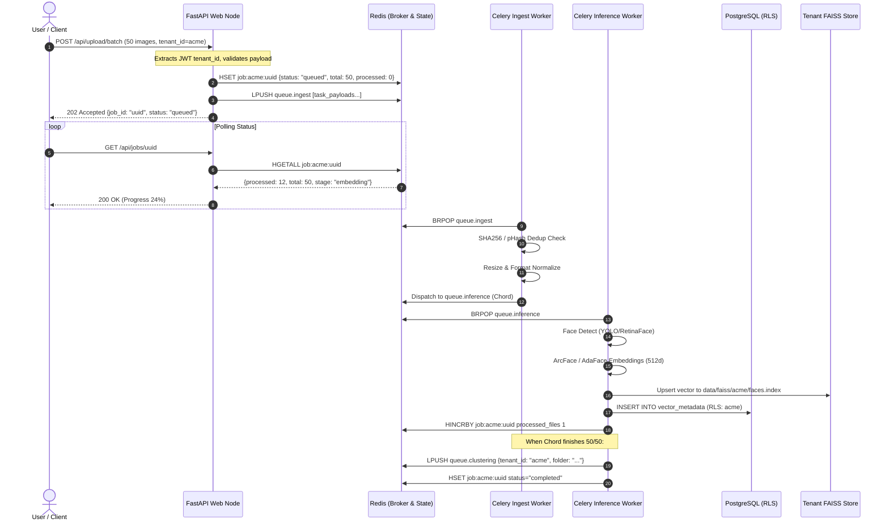

# Phase 2 Implementation Plan: Celery Distributed Worker Fleet & Asynchronous Queue Architecture

This document defines the architectural blueprint, technology selection rationale, queue topology, worker segregation, and execution roadmap for **Phase 2** of our enterprise SaaS modernization (as outlined in [`context/07_production_saas_scale_plan.md`](../context/07_production_saas_scale_plan.md)).

---

## 1. Executive Summary & Objective

### 1.1 The Problem with the Current Architecture
In Phase 1, we successfully achieved **stateless web tier decoupling**, **multi-tenant context isolation**, and **durable state persistence** (PostgreSQL with Row-Level Security, Redis distributed state, and tenant-partitioned vector indexes).

However, background processing currently runs in-process or via lightweight background loops inside the FastAPI container:
1. **CPU/GPU Contention on Web Threads**: When a user uploads 50 high-resolution photos, the AI model inferences (YOLO, InsightFace ArcFace, AdaFace, feature normalization) execute on the same container serving HTTP traffic. Under heavy batch ingestion, the web server's event loop starves, causing incoming search queries and health check pings (`/health`) to time out (504 Gateway Timeout).
2. **Crash & Deployment Vulnerability**: If the API container restarts, scales down, or crashes due to an Out-Of-Memory (OOM) error during heavy image decoding, **all active background processing jobs are killed mid-flight** without automated recovery or retry.
3. **Monolithic Resource Allocation**: Web serving requires low memory and high network I/O; AI inference requires intense compute (CPU SIMD or GPU VRAM). Running both in the same container forces over-provisioning expensive compute resources for simple web endpoints.
4. **No Backpressure or Queue Throttling**: If 10 users upload 100 images simultaneously, 1,000 images are processed concurrently without rate limits or queue prioritization, overwhelming network bandwidth, memory, or downstream compute pipelines.

### 1.2 Phase 2 North Star
> **Phase 2 establishes an asynchronous, distributed Celery Worker Fleet powered by Redis (or RabbitMQ), completely divorcing heavy image decoding, AI inference, and identity clustering from the FastAPI web tier.**

At the completion of Phase 2:
- The FastAPI web process will return HTTP `202 Accepted` within **< 15ms**, delegating all heavy computational work to specialized worker pools.
- Heavy workloads are routed across specialized priority queues (`ingest`, `inference`, `clustering`).
- Tasks feature automatic retry with exponential backoff, dead-letter queues (DLQ) for poisoned payloads, and perceptual deduplication (pHash/SHA256).
- Worker nodes can scale independently (e.g. via KEDA or Celery concurrency) without modifying or restarting the web API.

---

## 2. Technology Selection Rationale ("Why What?")

```
┌────────────────────────────────────────────────────────────────────────┐
│                      TECHNOLOGY DECISION MATRIX                        │
├──────────────────┬─────────────────────────────┬───────────────────────┤
│ Component        │ Selected Technology         │ Rejected Alternatives │
├──────────────────┼─────────────────────────────┼───────────────────────┤
│ Task Framework   │ Celery 5.4+                 │ ARQ / Dramatiq / RQ   │
│ Message Broker   │ Redis 7 (or Upstash / RMQ)  │ Kafka / AWS SQS       │
│ Result Backend   │ Redis (Hash State + TTL)    │ PostgreSQL Tables     │
│ Queue Separation │ Multi-Queue Topic Routing   │ Single Shared Queue   │
│ Object Storage   │ AWS S3 Bucket + CloudFront  │ Cloudinary / Local FS │
│ Deduplication    │ Perceptual Hash (pHash)     │ Raw Pixel Diff        │
│ Process Monitor  │ Celery Flower / Prometheus  │ Custom Polling Logger │
└──────────────────┴─────────────────────────────┴───────────────────────┘
```

### 2.1 Why Celery (over ARQ, Dramatiq, or RQ)?
- **Ecosystem Maturity & Battle-Tested Scale**: Celery is the industry standard Python distributed task queue, capable of processing hundreds of millions of tasks daily across Instagram, Robinhood, and Sentry.
- **Worker Segregation & Concurrency Models**: Supports `prefork` (multiprocessing for CPU/GPU-bound AI tasks), `gevent`/`eventlet` (for I/O-bound AWS S3 network calls), and single-thread threadpool isolation.
- **Advanced Task Primitives**: Built-in native support for Canvas workflows:
  - `chains`: Linear sequential pipelines (e.g., Ingest -> Detect -> Embed -> Index -> Cluster).
  - `groups` & `chords`: Parallel fan-out/fan-in (e.g., process 50 photos in parallel, then trigger a single cluster update callback once all complete).
- **Graceful Warm Shutdown**: Handles `SIGTERM` signals cleanly: finishes the active image embedding before allowing the pod to terminate during rolling deployments.

### 2.2 Why Redis as the Celery Broker & Backend?
- **Sub-Millisecond Message Dispatch**: Redis operates purely in-memory with atomic operations (`RPUSH`, `BLPOP`, `HSET`), providing latencies below 1ms per message dispatch.
- **Reusing Existing Infrastructure**: We already provisioned high-performance Redis in Phase 1 (with Upstash and local container support), eliminating the operational overhead of spinning up and maintaining RabbitMQ or Kafka for Phase 2.
- **Ephemeral State Expiration (TTL)**: Task progress and job logs naturally expire via Redis `EXPIRE` keys after 24–48 hours, preventing storage bloat without requiring manual cron cleanup jobs.

### 2.3 Why Dedicated Multi-Queue Routing (over a Single Queue)?
If all tasks share a single queue, long-running batch clustering jobs (which may take 30–60 seconds) will block fast single-image search pre-processing or high-priority single uploads.
We establish 3 dedicated queues:
1. `queue.ingest` (I/O-Bound): Image validation, metadata parsing, resizing, and AWS S3 upload with tenant partitioning.
2. `queue.inference` (Compute-Bound): Face detection, ArcFace/AdaFace embedding, and YOLO scene vector extraction.
3. `queue.clustering` (Memory/Math-Bound): HDBSCAN identity clustering and album medoid computation.

### 2.4 Why Perceptual Image Deduplication (pHash/SHA256)?
Users frequently upload duplicate or near-duplicate photos (e.g., burst mode shots, re-uploads, or identical photos across albums).
- **Exact Hash (SHA256)**: Identifies byte-for-byte duplicates immediately ($O(1)$ lookup in Redis/PostgreSQL). If an identical image has already been embedded for this tenant, we reuse the existing vector ID and skip 100% of the GPU/CPU inference costs.
- **Perceptual Hash (pHash / dHash)**: Computes image frequency distribution. Photos with minor compression differences or resized variants match with Hamming distance $\le 3$, avoiding redundant deep learning operations.

### 2.5 Why AWS S3 Bucket Storage (replacing Cloudinary)?
Cloudinary was initially used as a third-party prototype storage. For enterprise SaaS production scale:
- **Full Data Sovereignty & Zero Vendor Lock-in**: Raw media and customer assets are securely preserved in tenant-scoped object storage directly owned by our organization.
- **Tenant Path Isolation**: Object keys follow a strict convention: `s3://{BUCKET}/{tenant_id}/{folder}/{image_id}.jpg`, ensuring physical multi-tenant isolation and strict IAM policy enforcement.
- **Enterprise Economics**: At millions of images, AWS S3 is exponentially more cost-effective than proprietary media APIs.
- **Edge Delivery via AWS CloudFront CDN**: Public or presigned asset delivery is fronted by CloudFront edge nodes for sub-50ms latency across global geographic zones.
- **Direct Client Presigned Uploads**: Web and mobile clients can upload directly to S3 via presigned PUT URLs, completely bypassing backend web servers and offloading gigabytes of ingress traffic.

---

## 3. Architecture & Queue Topology ("Where and What")

```mermaid
flowchart TD
    Client["Client App / Web Frontend"] -->|POST /api/upload/batch| API["FastAPI Web Tier (Stateless)"]
    
    subgraph WebTier ["FastAPI Ingress (Stateless)"]
        API -->|1. Validate Headers & Auth| TokenValidation["Tenant Context<br/>& JWT Auth"]
        TokenValidation -->|2. Fast-Path Job Init| RedisState[("Redis State<br/>job:{tenant_id}:{job_id}")]
        TokenValidation -->|3. Publish Tasks| RedisBroker[("Redis Celery Broker<br/>redis://...")]
    end

    API -.->|HTTP 202 Accepted + job_id| Client

    subgraph QueueBackbone ["Redis Priority Queues"]
        RedisBroker --> Q1["Queue: queue.ingest<br/>(Priority High)"]
        RedisBroker --> Q2["Queue: queue.inference<br/>(Priority Normal)"]
        RedisBroker --> Q3["Queue: queue.clustering<br/>(Priority Low)"]
        RedisBroker --> QDLQ["Queue: queue.dlq<br/>(Dead-Letter Queue)"]
    end

    subgraph WorkerFleet ["Celery Distributed Worker Fleet"]
        subgraph IngestPool ["Ingest Workers (Concurrency: Eventlet/Prefork)"]
            W_Ingest1["Worker: Ingestion 1"]
            W_Ingest2["Worker: Ingestion 2"]
        end

        subgraph InferencePool ["Inference Workers (Concurrency: Prefork, GPU/CPU)"]
            W_Infer1["Worker: AI Embedder 1"]
            W_Infer2["Worker: AI Embedder 2"]
        end

        subgraph ClusterPool ["Clustering Workers (Solo/Dedicated)"]
            W_Cluster1["Worker: HDBSCAN Clusterer"]
        end
    end

    Q1 --> IngestPool
    Q2 --> InferencePool
    Q3 --> ClusterPool

    IngestPool -->|Upload Raw Image| S3Storage[("AWS S3 Bucket<br/>s3://bucket/{tenant_id}/...")]
    S3Storage -.->|Global Edge Caching| CloudFrontCDN[("AWS CloudFront CDN")]
    IngestPool -->|Forward Decoded Pixels| Q2
    
    InferencePool -->|Upsert Vectors| FAISSTier[("Tenant FAISS Index<br/>data/faiss/{tenant_id}/")]
    InferencePool -->|Commit Metadata (RLS)| PostgresDB[("PostgreSQL 16 Cluster")]
    InferencePool -->|Update Step %| RedisState

    ClusterPool -->|Read Vectors & Update Albums| PostgresDB

    InferencePool -.->|On 3 Failures| QDLQ
```

---

## 4. End-to-End Task Pipeline Flow



---

## 5. File Structure & Architectural Boundaries

```
visual-search-api/
├── main.py                             # Web entrypoint (Stateless API)
├── celery_app.py                       # Celery application instance & configuration
├── src/
│   ├── core/
│   │   ├── config.py                   # Celery broker & AWS S3 bucket configuration
│   │   └── tenant_context.py           # Contextvars propagation in workers
│   ├── tasks/                          # NEW: Celery Task Definitions
│   │   ├── __init__.py
│   │   ├── base.py                     # BaseTask with tenant context & error handling
│   │   ├── ingest_tasks.py             # Image validation, hashing, AWS S3 upload
│   │   ├── inference_tasks.py          # Face detection, embedding, vector indexing
│   │   └── clustering_tasks.py         # HDBSCAN clustering & album generation
│   ├── modules/
│   │   ├── storage/                    # Object storage adapters
│   │   │   ├── s3_storage.py           # AWS S3 multi-tenant storage provider
│   │   │   └── cloudinary_storage.py   # Legacy adapter (deprecated)
│   │   ├── deduplication/              # NEW: Perceptual & cryptographic hashing
│   │   │   ├── __init__.py
│   │   │   └── image_hasher.py         # SHA256 & pHash calculation
│   │   └── infra/
│   │       ├── postgres_repository.py  # DB persistence (RLS enabled)
│   │       ├── faiss_engine.py         # Partitioned vector store
│   │       └── kv_cache.py             # Redis distributed state
│   └── services/
│       ├── jobs.py                     # Job status polling & progress tracking
│       └── photo_upload_service.py     # Dispatches Celery task chains
├── docker-compose.yml                  # Includes web, worker-ingest, worker-infer, redis, postgres
└── Dockerfile                          # Shared multi-stage build for web & worker
```

---

## 6. Detailed Implementation Steps

### Step 1: Celery Application Factory & Broker Configuration (`celery_app.py`)
- Configure Celery with Redis broker and Redis result backend.
- Define explicit serialization settings:
  - `task_serializer = "json"`
  - `result_serializer = "json"`
  - `accept_content = ["json"]`
  - `timezone = "UTC"`
  - `task_acks_late = True` (guarantees tasks are re-queued if a worker crashes before completing).
  - `task_reject_on_worker_lost = True`.
- Configure task routing:
  ```python
  task_routes = {
      "src.tasks.ingest_tasks.*": {"queue": "queue.ingest"},
      "src.tasks.inference_tasks.*": {"queue": "queue.inference"},
      "src.tasks.clustering_tasks.*": {"queue": "queue.clustering"},
  }
  ```

### Step 2: Tenant Context Propagation in Celery (`src/tasks/base.py`)
- Workers execute in separate processes outside HTTP request/response loops.
- Implement a custom `TenantAwareTask(celery.Task)` base class:
  - Intercepts incoming kwargs: extracts `tenant_id`.
  - Sets `set_current_tenant_id(tenant_id)` before task execution (`before_start`).
  - Clears `reset_tenant_context()` on task completion (`after_return`).
  - Guarantees all database transactions and FAISS lookups executed by the worker are strictly scoped to the tenant.

### Step 3: Image Deduplication Module (`src/modules/deduplication/image_hasher.py`)
- Calculate cryptographic SHA256 checksum of raw image bytes.
- Calculate perceptual hash (difference hash or dHash) via Pillow:
  - Resize to $9 \times 8$ grayscale.
  - Compute adjacent pixel gradient (64-bit integer hash).
- If hash exists in PostgreSQL `vector_metadata` for that tenant:
  - Skip inference pipeline.
  - Link new image metadata record to existing vector integer ID.
  - Update progress counter immediately.

### Step 4: Specialized Celery Tasks
1. **`ingest_tasks.py`**:
   - `task_process_image_upload(image_path, folder_name, user_id, tenant_id)`:
   - Validates file integrity, calculates SHA256/pHash, uploads raw image to AWS S3 bucket under `{tenant_id}/{folder_name}/{image_id}.jpg` (served via CloudFront CDN or presigned URL), and forwards raw pixels/path to `task_extract_embeddings`.
2. **`inference_tasks.py`**:
   - `task_extract_embeddings(image_id, local_path, tenant_id, folder_name)`:
   - Runs face detection (YOLO / RetinaFace), extracts 512-dim ArcFace and AdaFace embeddings.
   - Upserts vectors into `data/faiss/{tenant_id}/faces.index`.
   - Records metadata in PostgreSQL `vector_metadata` with active tenant RLS session.
   - Increments Redis job progress hash.
3. **`clustering_tasks.py`**:
   - `task_run_face_clustering(folder_name, min_cluster_size, epsilon, tenant_id)`:
   - Loads tenant face vectors, runs HDBSCAN clustering, selects representative face medoids, and saves albums to PostgreSQL `face_clusters`.

### Step 5: Web Tier Delegation & Job Polling Update
- Update [`src/services/photo_upload_service.py`](file:///home/sudhanshu/Desktop/visual-search-api/src/services/photo_upload_service.py):
  - Ingest endpoints write image bytes to disk/cache, create the job entry in Redis, and call Celery `chord` or `group` across images:
    ```python
    task_chord = chord(
        [task_process_image_upload.s(img, folder, user_id, tenant_id) for img in images],
        task_batch_completion_callback.s(job_id, tenant_id)
    )
    task_chord.apply_async()
    ```
- Fast return to client with `job_id` and `status: "queued"`.

### Step 6: Docker Compose Multi-Service Fleet Setup
Update `docker-compose.yml` to spin up independent worker containers:
- `api`: FastAPI web server (`uvicorn main.py --host 0.0.0.0 --port 7860`).
- `worker-ingest`: `celery -A celery_app worker -Q queue.ingest -c 4 --loglevel=info`.
- `worker-inference`: `celery -A celery_app worker -Q queue.inference -c 2 --loglevel=info` (reserved for compute).
- `worker-clustering`: `celery -A celery_app worker -Q queue.clustering -c 1 --loglevel=info`.
- `postgres`: PostgreSQL 16 container.
- `redis`: Redis 7 container.
- `flower` (Optional): Celery monitoring web dashboard on port `5555`.

---

## 7. Verification & Testing Strategy

A dedicated test suite `tests/test_phase2_celery_workers.py` will verify:
1. **Queue Dispatch & Routing**:
   - Inspect dispatched task signatures to verify tasks land in the expected priority queue (`queue.ingest` vs `queue.inference`).
2. **Tenant Context Propagation in Worker**:
   - Verify that tasks executed by Celery workers maintain correct `tenant_id` without bleeding across threads.
3. **Perceptual Deduplication**:
   - Submitting an identical photo twice processes inference once and reuses existing vector metadata on the second pass.
4. **Resilience & Late Acks**:
   - Simulate a task worker failure; verify task remains in Redis queue and is retried.
5. **End-to-End Async Job Flow**:
   - Dispatch a batch upload; verify Redis job progress moves from `queued` -> `processing` -> `completed` and all vectors arrive in the tenant's FAISS partition.

---

## 8. Summary Comparison: Phase 1 vs Phase 2

| Feature | Phase 1 (Completed) | Phase 2 (This Plan) |
| :--- | :--- | :--- |
| **Database** | PostgreSQL 16 with RLS (SQLite dropped) | PostgreSQL 16 with RLS |
| **Object Storage** | AWS S3 Bucket (Partitioned: `{tenant}/{folder}`) | AWS S3 Bucket + CloudFront CDN + Celery Async Ingestion |
| **State Storage** | Redis Distributed Hash (`job:{tenant}:{id}`) | Redis Distributed Hash + Message Broker |
| **Processing Execution** | In-Process background task (`asyncio`) | Decoupled Celery Worker Fleet |
| **Web Tier Latency** | Variable (tied to local processing load) | Constant (< 15ms `202 Accepted`) |
| **Worker Scalability** | Fixed to Web Pod count | Auto-scaling per queue (KEDA / Celery) |
| **Failure Recovery** | Lost on container restart | Persistent queue, `acks_late`, automatic retries |
| **Deduplication** | None (re-computes embeddings) | Cryptographic (SHA256) & Perceptual (pHash) |
| **Queue Separation** | Single FIFO in Redis | Multi-Queue Priority Routing (`ingest`, `inference`, `clustering`) |

