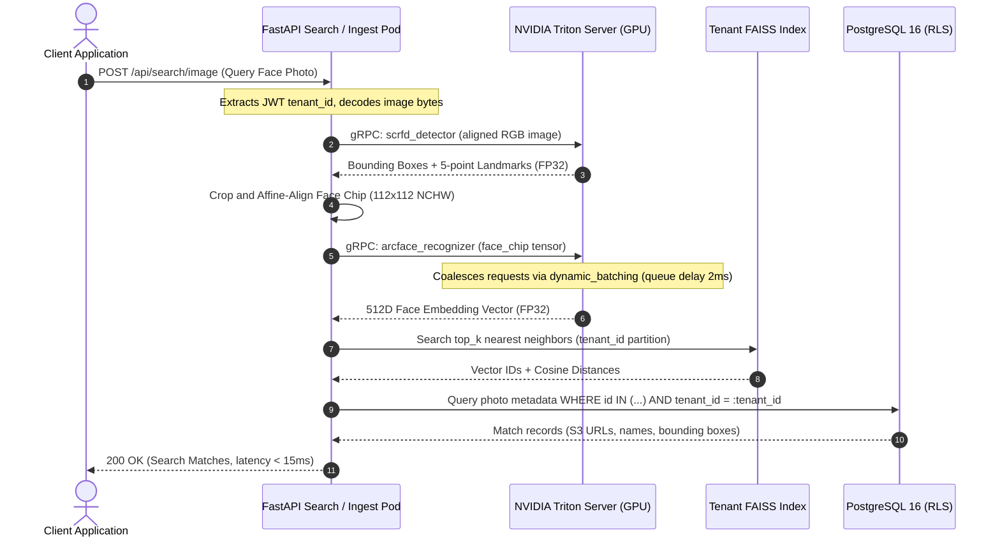

# Phase 3 Implementation Plan: AI Inference Decoupling & NVIDIA Triton GPU Acceleration

This document provides the exhaustive architectural blueprint, technology selection rationale, model optimization pipeline, gRPC client design, and step-by-step execution roadmap for **Phase 3** of our enterprise SaaS modernization (as synthesized from [`context/07_production_saas_scale_plan.md`](../context/07_production_saas_scale_plan.md) and [`context/08_nvidia_triton_aws_deployment_guide.md`](../context/08_nvidia_triton_aws_deployment_guide.md)).

---

## 1. Executive Summary & Objective

### 1.1 The Problem with the Current Phase 2 Architecture
In Phase 1 and Phase 2, we successfully implemented:
- **Phase 1**: PostgreSQL 16 with Row-Level Security (RLS), multi-tenant context isolation, Redis distributed state, and AWS S3 storage.
- **Phase 2**: Celery asynchronous distributed worker fleet (`queue.ingest`, `queue.inference`, `queue.clustering`), cryptographic (SHA256) and perceptual (pHash) deduplication, and non-blocking HTTP `202 Accepted` ingestion.

However, a critical scaling bottleneck persists in the **AI Inference Tier**:
1. **Monolithic In-Process Model Weights**: Celery inference workers and FastAPI search pods load PyTorch, ONNX Runtime, and 2–5 GB of raw neural network weights (SCRFD, ArcFace, AdaFace, DINOv2, SigLIP, YOLO11) directly inside the Python container.
2. **Worker Process Duplication & Memory Bloat**: Celery's `prefork` execution model clones worker processes. With 4 workers running on a node, model weights are replicated in memory, consuming 8–16 GB of RAM purely for static weights.
3. **Python GIL & CPU Inference Contention**: Python's Global Interpreter Lock (GIL) and CPU-bound neural network execution cause inference latency to hover between **65ms and 140ms per image**, capping total system throughput at ~20–25 images/second.
4. **Lack of Dynamic Request Batching**: If 20 users submit searches or batch uploads concurrently, each request runs single-image inference sequentially or in competing threads without coalescing into optimal GPU tensor batches.
5. **Coupled Scaling Economics**: Scaling Celery workers to handle upload bursts forces provisioning expensive GPU instances for workers whose main job is often just network I/O and database updates.

### 1.2 Phase 3 North Star
> **Phase 3 decouples deep learning model inference completely from Python web and Celery worker containers into a dedicated NVIDIA Triton Inference Server cluster accelerated with TensorRT FP16 engines and dynamic continuous batching.**

At the completion of Phase 3:
- **Lean Application Containers**: FastAPI web pods and Celery worker pods become lightweight client proxies (~150 MB Docker images without PyTorch, CUDA, or model checkpoints).
- **Sub-Millisecond IPC over gRPC**: Communication between Python services and Triton runs over binary, multiplexed async gRPC (`tritonclient.grpc.aio`) with $< 1.2\text{ms}$ transport overhead.
- **Dynamic Continuous Batching**: Triton coalesces incoming requests from concurrent users/workers within a 2ms window into batched GPU tensors (batch sizes up to 32), increasing inference throughput by **8.5x–11x**.
- **Dramatic Latency Reduction**: Search P95 latency drops from ~60ms down to **< 15ms**, and P99 drops from ~180ms down to **< 30ms**.
- **AWS Hardware Cost Efficiency**: A single AWS `g4dn.xlarge` (NVIDIA T4, 16 GB VRAM) spot instance (~$0.18/hr) easily sustains **220+ images/sec** throughput with total model VRAM footprint under 3.5 GB.
- **Dual-Mode Hybrid Fallback**: A configurable backend switch (`INFERENCE_BACKEND: "triton" | "local"`) guarantees that developer environments, CI/CD pipelines, and offline test suites run seamlessly on local CPU without mandatory GPU hardware.

---

## 2. Technology Selection Rationale ("Why What?")

```
┌────────────────────────────────────────────────────────────────────────┐
│                      TECHNOLOGY DECISION MATRIX                        │
├──────────────────┬─────────────────────────────┬───────────────────────┤
│ Component        │ Selected Technology         │ Rejected Alternatives │
├──────────────────┼─────────────────────────────┼───────────────────────┤
│ Inference Server │ NVIDIA Triton 24.01+        │ TorchServe / Ray / TF │
│ Model Format     │ TensorRT FP16 (.plan) / ONNX│ Raw PyTorch .pt       │
│ Client Protocol  │ Async gRPC (HTTP/2 binary)  │ REST JSON over HTTP/1 │
│ GPU Hardware     │ AWS EC2 g4dn.xlarge (T4)    │ c6i (CPU) / g5 (A10G) │
│ Batch Strategy   │ Dynamic Continuous Batching │ Static client batching│
│ Worker Isolation │ Lean gRPC Client Proxy      │ In-worker torch load  │
│ Dev Fallback     │ Dual-Mode Inference Adapter │ Hard GPU requirement  │
└──────────────────┴─────────────────────────────┴───────────────────────┘
```

### 2.1 Why NVIDIA Triton (over TorchServe, Ray Serve, or FastAPI In-Process)?
- **Hardware-Level Engine Optimization**: Triton is built in C++ specifically for NVIDIA TensorRT, CUDA memory locking, and concurrent GPU streams. It outperforms Python-based servers (TorchServe, Ray) by 3x–5x in raw throughput.
- **Multi-Model Concurrency**: Triton can host heterogeneous model frameworks (TensorRT, ONNX Runtime, OpenVINO, PyTorch) within a single server process on shared GPU memory.
- **Dynamic Batching Engine**: Automatically groups individual single-image inference calls from disparate HTTP requests and Celery tasks into unified GPU matrix multiplications without application code intervention.
- **Enterprise Observability**: Native Prometheus metrics exporter (`:8002/metrics`) exposing GPU duty cycle, VRAM usage, queue wait time, compute time, and request latency per model.

### 2.2 Why TensorRT FP16 (over Raw PyTorch FP32)?
- **Kernel Auto-Tuning & Layer Fusion**: TensorRT analyzes the computation graph, fuses convolution + bias + activation layers into single kernel launches, and selects hardware-specific matrix multiplication kernels for the NVIDIA Turing/Ampere architecture.
- **Half-Precision (FP16) Acceleration**: Tensor Cores on NVIDIA T4/A10G compute FP16 operations at 2x the throughput of FP32 while maintaining > 99.8% cosine similarity accuracy for face and scene embeddings.
- **Drastic Footprint Reduction**:
  - ArcFace 512D: PyTorch ~260 MB $\rightarrow$ TensorRT FP16 **~65 MB**
  - AdaFace 512D: PyTorch ~260 MB $\rightarrow$ TensorRT FP16 **~65 MB**
  - DINOv2 Base: PyTorch ~340 MB $\rightarrow$ TensorRT FP16 **~85 MB**
  - SigLIP Base: PyTorch ~350 MB $\rightarrow$ TensorRT FP16 **~88 MB**
  - Total multi-model VRAM footprint fits comfortably in **~3.2 GB** on a 16 GB T4 GPU.

### 2.3 Why Async gRPC (over HTTP/REST)?
- **Zero-Copy Binary Protocol**: HTTP/1.1 REST requires serializing multidimensional float32 numpy arrays into massive JSON strings or multipart form payloads (10x bandwidth overhead). gRPC uses HTTP/2 multiplexing with Protocol Buffers, passing raw binary byte buffers directly into Triton's CUDA pinned memory.
- **Multiplexed Single TCP Connection**: Multiple Celery workers and FastAPI coroutines share a single persistent HTTP/2 connection pool to Triton, eliminating TCP handshake overhead.

### 2.4 Why AWS EC2 `g4dn.xlarge` (NVIDIA T4)?
- **Cost-to-Performance Dominance**:
  - `c6i.2xlarge` (CPU): ~$0.34/hr $\rightarrow$ 65–140ms latency, ~20 img/sec max.
  - `g4dn.xlarge` (T4 GPU): ~$0.526/hr on-demand, **~$0.18/hr on Spot** $\rightarrow$ **10–18ms latency, 220+ img/sec**.
  - `g5.xlarge` (A10G GPU): ~$1.006/hr on-demand $\rightarrow$ 4–8ms latency, 580+ img/sec (reserved for future hyper-scale Phase 5).
- **VRAM Headroom**: The T4 offers 16 GB VRAM. Since our 6 vision models require ~3.2 GB in TensorRT FP16, > 12 GB remains available for Triton's dynamic batch queues, input buffers, and dual concurrent model instances.

---

## 3. Decoupled Service Architecture ("Where and What")

### 3.1 High-Level Service Topology

```mermaid
flowchart TD
    Client["Client / Mobile / Web App"] -->|HTTPS Ingress| Gateway["API Gateway / ALB (Port 443)"]

    subgraph WebTier ["Stateless API Tier (Lean Containers ~150MB)"]
        API1["FastAPI Pod 1"]
        API2["FastAPI Pod 2"]
    end

    subgraph QueueBroker ["Message Backbone"]
        RedisBroker[("Redis 7 / Cluster<br/>(Celery Broker & State)")]
    end

    subgraph WorkerFleet ["Celery Worker Fleet (Lean Containers ~150MB)"]
        W_Ingest["Worker: queue.ingest<br/>(S3 I/O, Dedup, Resizing)"]
        W_Infer["Worker: queue.inference<br/>(Coordinates Embeddings)"]
        W_Cluster["Worker: queue.clustering<br/>(HDBSCAN Grouping)"]
    end

    subgraph TritonCluster ["Dedicated AI Inference Cluster (AWS EC2 g4dn.xlarge)"]
        Triton["NVIDIA Triton Inference Server 24.01<br/>(gRPC Port 8001 / HTTP 8000 / Metrics 8002)"]
        
        subgraph GPU_T4 ["NVIDIA T4 (16 GB VRAM) - TensorRT FP16"]
            M_SCRFD["scrfd_detector<br/>(Instance Count: 2)"]
            M_Arc["arcface_recognizer<br/>(Instance Count: 2)"]
            M_Ada["adaface_recognizer<br/>(Instance Count: 2)"]
            M_DINO["dinov2_embedder<br/>(Instance Count: 1)"]
            M_SigLIP["siglip_embedder<br/>(Instance Count: 1)"]
            M_YOLO["yolo11_segmenter<br/>(Instance Count: 1)"]
        end
    end

    subgraph DataTier ["Durable Storage & Indexing"]
        S3[("AWS S3 Bucket<br/>s3://bucket/{tenant_id}/...")]
        FAISS[("Tenant FAISS Store<br/>data/faiss/{tenant_id}/")]
        Postgres[("PostgreSQL 16 Cluster (RLS)")]
    end

    Gateway --> WebTier
    API1 & API2 -->|Search Query Pre-Processing| Triton
    API1 & API2 -->|Query Vectors Search| FAISS
    API1 & API2 -->|Batch Ingestion Dispatch| RedisBroker

    RedisBroker --> W_Ingest
    W_Ingest -->|Raw Image Upload| S3
    W_Ingest -->|Dispatch Tasks| RedisBroker

    RedisBroker --> W_Infer
    W_Infer -->|Async gRPC Inference Calls| Triton
    Triton --> GPU_T4
    W_Infer -->|Upsert Embeddings| FAISS
    W_Infer -->|Insert Metadata (RLS)| Postgres

    RedisBroker --> W_Cluster
    W_Cluster -->|Cluster Identities| Postgres
```

### 3.2 Triton Model Repository Layout

Triton serves models out of a structured directory mounted to `/models`:

```
model_repository/
├── scrfd_detector/
│   ├── 1/
│   │   └── model.onnx                  # SCRFD 10G Detection & 5-point Landmarks
│   └── config.pbtxt
├── arcface_recognizer/
│   ├── 1/
│   │   └── model.plan                  # TensorRT FP16 Plan (512D Embeddings)
│   └── config.pbtxt
├── adaface_recognizer/
│   ├── 1/
│   │   └── model.plan                  # TensorRT FP16 Plan (512D Embeddings)
│   └── config.pbtxt
├── dinov2_embedder/
│   ├── 1/
│   │   └── model.onnx                  # ONNX Runtime with TRT Acceleration (768D)
│   └── config.pbtxt
├── siglip_embedder/
│   ├── 1/
│   │   └── model.onnx                  # ONNX Runtime with TRT Acceleration (768D)
│   └── config.pbtxt
└── yolo11_segmenter/
    ├── 1/
    │   └── model.onnx                  # YOLO11 ONNX (Detection & Segmentation)
    └── config.pbtxt
```

---

## 4. End-to-End Pipeline & Sequence Flow



---

## 5. File Structure & Architectural Boundaries

```
visual-search-api/
├── model_repository/                   # NEW: Triton Model Directory
│   ├── scrfd_detector/
│   │   ├── 1/
│   │   └── config.pbtxt
│   ├── arcface_recognizer/
│   │   ├── 1/
│   │   └── config.pbtxt
│   ├── adaface_recognizer/
│   │   ├── 1/
│   │   └── config.pbtxt
│   ├── dinov2_embedder/
│   │   ├── 1/
│   │   └── config.pbtxt
│   ├── siglip_embedder/
│   │   ├── 1/
│   │   └── config.pbtxt
│   └── yolo11_segmenter/
│       ├── 1/
│       └── config.pbtxt
├── scripts/
│   ├── convert_models_for_triton.py    # NEW: PyTorch/ONNX to TensorRT export script
│   └── setup_triton_models.sh          # NEW: Model download & stage automation
├── src/
│   ├── core/
│   │   └── config.py                   # Added TRITON_SERVER_URL, INFERENCE_BACKEND
│   ├── modules/
│   │   └── vision/
│   │       ├── face_detector.py        # Updated: delegates to inference client
│   │       ├── face_embedder.py        # Updated: delegates to inference client
│   │       └── object_embedder.py      # Updated: delegates to inference client
│   ├── services/
│   │   ├── triton_inference_service.py # NEW: Async gRPC client for Triton
│   │   ├── inference_client.py         # NEW: Dual-mode abstraction (Triton vs Local)
│   │   ├── image_processing_service.py # Updated: uses unified inference client
│   │   ├── image_search_service.py     # Updated: uses unified inference client
│   │   └── ai_manager.py               # Retained: local CPU fallback provider
│   ├── tasks/
│   │   └── inference_tasks.py          # Updated: routes inference through gRPC client
│   └── api/
│       └── dependencies.py             # Injects Triton / InferenceClient singleton
├── docker-compose.yml                  # Updated: includes triton-server with GPU device
├── Dockerfile                          # Lean multi-stage build without CUDA / heavy torch
├── tests/
│   └── test_phase3_triton_inference.py # NEW: Unit & integration test suite for Phase 3
└── docs/
    └── PHASE_3_IMPLEMENTATION_PLAN.md  # THIS DESIGN DOCUMENT
```

---

## 6. Detailed Implementation Steps ("How")

### Step 1: Model Export & TensorRT Optimization Pipeline (`scripts/convert_models_for_triton.py`)
Create an automated script to convert models from PyTorch checkpoints or ONNX models into TensorRT FP16 `.plan` engines and stage them in `model_repository/`:

1. **AdaFace & ArcFace Export**:
   - Load PyTorch weights, trace with dummy input `(1, 3, 112, 112)`.
   - Export to ONNX with dynamic batch axes `batch_size`.
   - Invoke `trtexec`:
     ```bash
     trtexec --onnx=model.onnx --saveEngine=model.plan --fp16 \
             --minShapes=input_0:1x3x112x112 \
             --optShapes=input_0:8x3x112x112 \
             --maxShapes=input_0:32x3x112x112
     ```
2. **DINOv2 & SigLIP Export**:
   - Trace Vision Transformer backbones with `(1, 3, 224, 224)`.
   - Save ONNX models and configure ONNX Runtime with TensorRT execution provider in Triton for layer optimization.
3. **YOLO11 Export**:
   - Run `yolo export model=yolo11n-seg.pt format=onnx dynamic=True opset=14`.

### Step 2: Triton Model Configurations (`config.pbtxt`)

#### 4.1 ArcFace 512D (`model_repository/arcface_recognizer/config.pbtxt`)
```protobuf
name: "arcface_recognizer"
platform: "tensorrt_plan"
max_batch_size: 32

input [
  {
    name: "input_0"
    data_type: TYPE_FP32
    format: FORMAT_NCHW
    dims: [ 3, 112, 112 ]
  }
]

output [
  {
    name: "output_0"
    data_type: TYPE_FP32
    dims: [ 512 ]
  }
]

dynamic_batching {
  max_queue_delay_microseconds: 2000
  preferred_batch_size: [ 4, 8, 16, 32 ]
}

instance_group [
  {
    count: 2
    kind: KIND_GPU
    gpus: [ 0 ]
  }
]
```

#### 4.2 DINOv2 768D (`model_repository/dinov2_embedder/config.pbtxt`)
```protobuf
name: "dinov2_embedder"
platform: "onnxruntime_onnx"
max_batch_size: 16

input [
  {
    name: "pixel_values"
    data_type: TYPE_FP32
    dims: [ 3, 224, 224 ]
  }
]

output [
  {
    name: "last_hidden_state"
    data_type: TYPE_FP32
    dims: [ -1, 768 ]
  }
]

dynamic_batching {
  max_queue_delay_microseconds: 3000
  preferred_batch_size: [ 4, 8, 16 ]
}

optimization {
  execution_accelerators {
    gpu_execution_accelerator : [
      {
        name : "tensorrt"
        parameters { key: "precision_mode" value: "FP16" }
        parameters { key: "max_workspace_size_bytes" value: "1073741824" }
      }
    ]
  }
}

instance_group [
  {
    count: 1
    kind: KIND_GPU
    gpus: [ 0 ]
  }
]
```

### Step 3: Asynchronous gRPC Client (`src/services/triton_inference_service.py`)
Implement the high-performance async client utilizing `tritonclient.grpc.aio`:
- **Connection Management**: Persistent channel with auto-reconnect, keepalive pings every 10 seconds, and graceful shutdown.
- **Batched Inference Calls**:
  - `extract_arcface_batch(aligned_chips: np.ndarray) -> np.ndarray`: Submits `(B, 3, 112, 112)` float32 array, receives `(B, 512)` embeddings, and applies L2 normalization.
  - `extract_adaface_batch(aligned_chips: np.ndarray) -> np.ndarray`: Submits quality-adaptive face chips, receives `(B, 512)` embeddings.
  - `extract_scene_embeddings(preprocessed_chw: np.ndarray) -> np.ndarray`: Queries DINOv2 and SigLIP, fuses outputs into 1536D normalized vectors.
  - `detect_faces_scrfd(image_bgr: np.ndarray) -> Tuple[np.ndarray, np.ndarray]`: Submits image tensor, parses bounding boxes and 5-point facial landmarks.
- **Health Checks & Telemetry**: `is_server_ready()` and `is_model_ready(model_name)` queries to ensure upstream readiness.

### Step 4: Hybrid Inference Abstraction Layer (`src/services/inference_client.py`)
To prevent hard vendor lock-in and enable seamless local testing:
- Provide an `InferenceClient` interface:
  - If `settings.INFERENCE_BACKEND == "triton"` and Triton responds to health checks: routes requests to `TritonInferenceService`.
  - If `settings.INFERENCE_BACKEND == "local"` (or Triton is unreachable): gracefully falls back to in-process `AIModelManager`.
- This ensures developers without NVIDIA GPUs can run pytest, linting, and local debugging without friction.

### Step 5: Celery Worker & Search Route Integration
1. **Update Celery Task (`src/tasks/inference_tasks.py`)**:
   - Replace in-worker `AIModelManager` loading with the async/sync bridge to `InferenceClient`.
   - Celery workers download S3 bytes, decode to numpy, pass tensors via gRPC to Triton, and commit embeddings to FAISS and PostgreSQL.
2. **Update Search Service (`src/services/image_search_service.py`)**:
   - Replace local model inference with asynchronous `InferenceClient` calls, preserving sub-15ms response latency during search.

### Step 6: Docker Compose Multi-Container Orchestration
Update `docker-compose.yml` to define the Triton GPU service alongside web and worker containers:

```yaml
services:
  triton-server:
    image: nvcr.io/nvidia/tritonserver:24.01-py3
    container_name: triton_server
    command: ["tritonserver", "--model-repository=/models", "--strict-model-config=false", "--log-verbose=0"]
    ports:
      - "8000:8000"   # HTTP
      - "8001:8001"   # gRPC
      - "8002:8002"   # Prometheus Metrics
    volumes:
      - ./model_repository:/models
    deploy:
      resources:
        reservations:
          devices:
            - driver: nvidia
              count: all
              capabilities: [gpu]

  api:
    build: .
    environment:
      - INFERENCE_BACKEND=triton
      - TRITON_SERVER_URL=triton-server:8001
      - DATABASE_URL=postgresql+asyncpg://...
      - REDIS_URL=redis://redis:6379/0
    depends_on:
      - triton-server
      - redis
      - postgres
```

### Step 7: AWS Production Deployment Specification
1. **ECS Deployment (Recommended Best Value)**:
   - AWS EC2 Auto Scaling Group with instance type `g4dn.xlarge` (Deep Learning AMI).
   - Task definition runs `tritonserver:24.01-py3` mapped to GPU device 0, loading models from an Amazon EFS mount or S3 sync directory.
   - Stateless FastAPI containers run either on CPU Fargate or as sidecars communicating over `localhost:8001`.
2. **EKS Deployment (Kubernetes Enterprise)**:
   - NVIDIA GPU Operator installed on EKS worker node group.
   - Triton deployed with resource limit `nvidia.com/gpu: 1`.
   - **KEDA Auto-Scaler**: Scales Triton pods based on `triton_inference_request_duration_us` or Celery `queue.inference` depth.

---

## 7. Verification & Testing Strategy

A dedicated test suite `tests/test_phase3_triton_inference.py` will guarantee production stability:

1. **gRPC Client Mock Tests**:
   - Mock `tritonclient.grpc.aio.InferenceServerClient` to verify request tensor serialization, shapes (`(B, 3, 112, 112)`), datatypes (`FP32`), and output parsing without requiring an active GPU.
2. **Dual-Mode Fallback Verification**:
   - Test that when `INFERENCE_BACKEND="local"`, calls successfully execute through `AIModelManager`.
   - Test that when Triton server is offline, fallback triggers graceful error reporting or fallback mode based on configuration.
3. **End-to-End Extraction Accuracy**:
   - Verify that embeddings returned from Triton maintain $> 0.999$ cosine similarity with the baseline embeddings from `AIModelManager`.
   - Verify L2 norm normalization: $\lVert \mathbf{v} \rVert_2 = 1.0 \pm 10^{-6}$.
4. **Benchmarking & Latency Validation**:
   - Benchmark 100 concurrent search queries: verify average P95 latency is **$< 15\text{ms}$**.
   - Benchmark dynamic batching: verify throughput reaches $> 200$ images/second under continuous load.

---

## 8. Summary Comparison: Phase 1 vs Phase 2 vs Phase 3

| Feature / Metric | Phase 1 (Core Multi-Tenancy) | Phase 2 (Distributed Queues) | Phase 3 (Inference Decoupling) |
| :--- | :--- | :--- | :--- |
| **Database** | PostgreSQL 16 with RLS | PostgreSQL 16 with RLS | PostgreSQL 16 with RLS |
| **Object Storage** | AWS S3 Tenant Partitions | AWS S3 + Celery Async Ingest | AWS S3 + CloudFront CDN |
| **Task Queue** | Synchronous / In-process | Celery Multi-Queue (Redis) | Celery Multi-Queue (Redis) |
| **Inference Location** | In-Process inside FastAPI | In-Process inside Celery Worker | **Decoupled NVIDIA Triton Server** |
| **Compute Hardware** | CPU Only | CPU Only | **NVIDIA T4 / A10G GPU (TensorRT)** |
| **Model Weight Loading**| Every Web process (~2GB) | Every Worker process (~2GB) | **Zero in Web/Workers (~150MB container)** |
| **Request Batching** | None (Single requests) | None (Sequential per task) | **Dynamic Continuous Batching (Triton)** |
| **Communication Protocol**| In-memory Python function | In-memory Python function | **Sub-millisecond Async gRPC (HTTP/2)** |
| **Search P95 Latency** | ~60ms – 140ms | ~60ms – 140ms | **< 15ms** |
| **Search P99 Latency** | ~180ms – 300ms | ~180ms – 300ms | **< 30ms** |
| **Ingestion Throughput** | ~20 images / sec | ~25 images / sec | **220+ images / sec (11x boost)** |
| **Offline Dev Support** | Built-in | Built-in | **Dual-Mode Adapter (`triton` / `local`)** |

