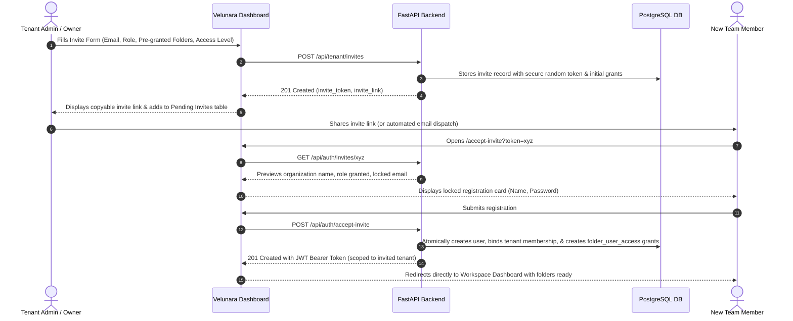

# Velunara Workspace & Security Architecture Specification
## Profile Dashboard, Role-Based Workspaces, Invitation Management & Concurrency Safeguards

---

### 1. Executive Summary & Core Requirements

This document specifies the end-to-end frontend and backend interaction model for **Velunara**'s workspace security, role-differentiated user dashboards, multi-modal search, and team collaboration workflows.

It directly addresses:
1. **Authenticated User Profile & Workspace Dashboard:** An on-login dashboard detailing active organizations, accessible collections, and roles.
2. **Role-Differentiated Experiences (Admin vs. Manager vs. Regular User):** Strict segregation of capabilities, collection management, member invitations, and transparent access visibility.
3. **Duplicate Folder Name Concurrency & Race-Condition Defense:** Two-layer transactional enforcement (FastAPI validation + PostgreSQL composite UNIQUE constraint) when multiple managers create folders simultaneously.
4. **Multi-Modal Visual Search (Image + Natural Language Text):** Allowing users to upload reference portraits or enter plain-text scene queries, scoped strictly to their permitted collections.
5. **Full Invitation Lifecycle:** How invitations are created by authorized admins, previewed publicly, accepted by users, and tied to auto-granted folder access.
6. **Secure Multi-Tenant Switching:** Instant cache purging, scoped JWT re-issuance, and dynamic navbar reflection.

---

### 2. Role-Differentiated User Dashboard Matrix

When a user logs in or accesses their profile dashboard (`/profile` or profile menu trigger), the UI queries their identity, tenant memberships, and collection rights. The interface dynamically adapts based on the active role:

```
┌────────────────────────────────────────────────────────────────────────┐
│                       AUTHENTICATED USER HUB                           │
│  [User Avatar]  Marcus Chen  (marcus@studioalpha.com)                  │
│  Active Workspace: Studio Alpha  ·  Role: [ Studio Admin ]             │
│  Switch Workspace: [ Studio Alpha (Active) ] [ Apex Media Agency ]     │
└──────────────────────────────────┬─────────────────────────────────────┘
                                   │
         ┌─────────────────────────┼─────────────────────────┐
         ▼                         ▼                         ▼
┌──────────────────┐      ┌──────────────────┐      ┌──────────────────┐
│   ADMIN / OWNER  │      │     MANAGER      │      │  REGULAR USER    │
│    DASHBOARD     │      │    DASHBOARD     │      │ (VIEWER/UPLOADER)│
├──────────────────┤      ├──────────────────┤      ├──────────────────┤
│ • Full Folder    │      │ • Managed Folders│      │ • Permitted      │
│   Inventory (All)│      │   Inventory      │      │   Folders Only   │
│ • Create & Delete│      │ • Create Folders │      │ • View & Search  │
│   Any Collection │      │   (Becomes Mgr)  │      │   Badges Only    │
│ • Send Team      │      │ • Member Details │      │ • Zero Admin     │
│   Invitations    │      │   ("Who else can │      │   or Sharing     │
│ • Pre-Grant      │      │    edit/view")   │      │   Controls       │
│   Folder Access  │      │ • Granular Sharing│     │ • Clean Gallery  │
│ • Promote/Demote │      │   Matrix for     │      │   Browsing Only  │
│   Members        │      │   Owned Folders  │      │                  │
└──────────────────┘      └──────────────────┘      └──────────────────┘
```

#### Detailed Breakdown by Persona:

| Feature / Capability | Organization Admin / Owner | Folder Manager / Editor | Contributor / Regular Viewer |
| :--- | :---: | :---: | :---: |
| **Visible Collections** | All collections in tenant | Collections where user has `manager` / `editor` access | Strictly `allowed_folders` granted to user |
| **Create New Collection** | Yes (`POST /api/folders`) | Yes (auto-granted `manager` level atomically) | No (hidden from view) |
| **Delete Collection** | Yes (`DELETE /api/folders/{id}`) | Yes (for collections they manage) | No |
| **View Access Details** | Full tenant member directory | Shows *who else can make changes and view* (`GET /api/folders/{id}/members`) | No |
| **Edit Folder Permissions** | Yes (`POST /api/folders/{id}/access/bulk`) | Yes (for collections they manage) | No |
| **Invite New Team Members**| Yes (`POST /api/tenant/invites`) | No (prompted to contact Admin/Owner) | No |
| **Pre-grant Folders on Invite**| Yes (assigns folders upon invite acceptance) | No | No |
| **Switch Active Organization** | Yes (`POST /api/auth/switch-tenant`) | Yes | Yes |

---

### 3. Invitation Management Lifecycle & User Flow

Invitations allow organizations to onboard staff, photographers, and agency clients securely without leaking unpermitted archives.



#### API Endpoint Specifications:
1. **Send Invitation (`POST /api/tenant/invites`):**
   - **Auth Required:** `Owner` or `Admin` role.
   - **Request Payload:**
     ```json
     {
       "email": "photographer@agency.com",
       "role": "contributor",
       "initial_folder_ids": ["fld_gala_01", "fld_keynote_02"],
       "initial_access_level": "uploader"
     }
     ```
   - **Response Payload:**
     ```json
     {
       "invite_id": "inv_9a8b7c6d5e",
       "email": "photographer@agency.com",
       "role": "contributor",
       "token": "tok_sec_1a2b3c4d5e",
       "invite_link": "https://velunara.app/accept-invite?token=tok_sec_1a2b3c4d5e",
       "expires_at": "2026-10-28T12:00:00Z",
       "created_at": "2026-10-21T12:00:00Z"
     }
     ```
2. **Public Token Preview (`GET /api/auth/invites/{token}`):**
   - Public endpoint (no auth required).
   - Validates token expiry and returns organization branding, locked email, and role.
3. **Accept Invitation (`POST /api/auth/accept-invite`):**
   - Creates member credentials, sets password hash, and writes explicit grants into `folder_user_access`.

---

### 4. Concurrency Security: Duplicate Folder Creation Defense

#### Threat Scenario
Two managers within the same organization (e.g., `Studio Alpha`) simultaneously attempt to create a folder with the identical name (e.g., `Gala_2026`) at the exact same millisecond. If not properly guarded, this could cause orphaned ACL mappings, vector index corruption, or data cross-contamination.

#### Defense-in-Depth Solution:

```
[ Manager A Request ] ───────┐
                              ▼
                       FastAPI Server
[ Manager B Request ] ───────▲
                              │
  [Layer 1: Application Check]
  existing = repo.get_folder_by_name(clean_name, tenant_id)
  ──> If found, raises HTTP 409 Conflict immediately.
                              │
  [Layer 2: PostgreSQL Transactional Concurrency]
  INSERT INTO folders (folder_id, tenant_id, folder_name, ...)
  ──> Protected by Composite Unique Constraint:
      CONSTRAINT uq_tenant_folder_name UNIQUE (tenant_id, folder_name)
                              │
  Winner succeeds (201 Created).
  Loser transaction aborted by Postgres with unique violation -> Caught -> 409 Conflict.
```

#### Frontend Validation & Error Recovery:
- The frontend intercepts any `HTTP 409 Conflict` response from `POST /api/folders`.
- Rather than crashing or showing a generic alert, the modal highlights the name input:
  *"A collection named 'Gala_2026' already exists in this workspace. Please choose a distinct name."*

---

### 5. Multi-Modal Visual Search Studio: Image + Natural Language Text

#### Dual Search Modes:
1. **Mode A — Face Reference Image Search (`POST /api/search/image`):**
   - User uploads a portrait photograph or selects a person medoid from the People directory.
   - The backend runs RetinaFace landmark detection and ArcFace 512-dimensional vector comparison.
   - User adjusts sensitivity: `Broad` (0.45 threshold), `Balanced` (0.60 threshold), or `Exact` (0.75 threshold).
2. **Mode B — Plain-Text Semantic Scene Query:**
   - User types natural language descriptions:
     - *"Keynote speakers on stage under spotlights"*
     - *"Candid outdoor team lunch in the courtyard"*
     - *"VIP red carpet step-and-repeat arrival"*
   - The backend matches vectors using CLIP scene/object embeddings.

#### Folder Scope Dropdown & Profile Navigation Shortcut:
- **Permitted Collections Dropdown:**
  - Contains **only the collections in which search is permitted for the active user** (`allowed_folders`).
  - Pre-filters candidate search vectors strictly at query time, guaranteeing zero vector data leakage across restricted collections.
- **Direct Navigation Shortcut:**
  - Located directly below the collection scope dropdown:
    ```html
    <div class="search-scope-footer">
      <span>Need a new collection or need to invite collaborators?</span>
      <a href="#profile" class="editorial-link" id="nav-to-profile-dashboard">
        Go to Profile &amp; Workspace Dashboard &rarr;
      </a>
    </div>
    ```
  - Clicking transitions the user directly to their role-differentiated dashboard, where authorized users can create collections or invite teammates.

---

### 6. Secure Multi-Tenant Switching & Dynamic Navbar Refresh

#### Flow:
1. User clicks another organization in the workspace switcher dropdown or Profile Dashboard.
2. Frontend calls `POST /api/auth/switch-tenant` with `{ "target_tenant_id": "org_xyz" }` and existing JWT.
3. Backend verifies the user has an active membership record in `target_tenant_id` and mints a fresh JWT containing:
   - `sub`: User ID
   - `tenant_id`: New organization ID
   - `role`: User's specific role in that new organization (e.g. `viewer` in Org B even if `owner` in Org A)
4. Frontend updates `authStore` and `workspaceStore`:
   - Completely flushes cached collections, search history, and cluster medoids to prevent data bleed.
   - Updates the top navbar:
     - Organization name badge and initials.
     - Role indicator pill.
     - Toggles management tabs (`Upload`, `Collections`, `People`) based on new tenant permissions.
   - Re-renders the active view scoped strictly to the new organization.

---

### 7. Complete API Route & Contract Reference

| Endpoint | Method | Role Required | Payload / Query | Output Contract |
| :--- | :---: | :---: | :--- | :--- |
| `/api/auth/login` | `POST` | Public | `{ email, password }` | Single tenant: `{ token, tenant_id, role }`; Multi-tenant: `{ status: "select_tenant", available_tenants: [...] }` |
| `/api/auth/switch-tenant` | `POST` | Authenticated | `{ target_tenant_id }` | `{ access_token, token_type: "bearer", tenant_id, role }` |
| `/api/auth/invites/{token}` | `GET` | Public | `invite_token` | `{ email, organization_name, role, expires_at }` |
| `/api/auth/accept-invite` | `POST` | Public | `{ token, full_name, password }` | `{ access_token, tenant_id, role }` |
| `/api/tenant/invites` | `POST` | `Admin`, `Owner` | `{ email, role, initial_folder_ids, initial_access_level }` | `{ invite_id, token, invite_link, expires_at }` |
| `/api/tenant/members` | `GET` | Authenticated | `limit=50, offset=0` | `List[TenantMemberItem]` (`user_id, username, email, role, created_at`) |
| `/api/tenant/members/{id}/role` | `PATCH` | `Admin`, `Owner` | `{ role: "admin" \| "contributor" \| "viewer" }` | `{ status: "success", user_id, new_role }` |
| `/api/tenant/members/{id}` | `DELETE` | `Admin`, `Owner` | Path param `user_id` | `{ status: "success", message: "User removed from organization" }` |
| `/api/folders` | `GET` | Authenticated | Optional `?search=...` | `List[FolderResponse]` (`folder_id, folder_name, visibility, photo_count, can_upload, can_manage, can_delete`) |
| `/api/folders` | `POST` | `Admin`, `Owner`, `Contributor` | `{ folder_name, description, visibility }` | `FolderResponse` (creator automatically bound as `manager`) |
| `/api/folders/{id}` | `DELETE` | `Manager`, `Admin`, `Owner` | Path param `folder_id` | `{ status: "success", folder_id }` |
| `/api/folders/{id}/members` | `GET` | `Manager`, `Admin`, `Owner` | Path param `folder_id` | `List[FolderMemberAccessItem]` (shows who can view/add/manage) |
| `/api/folders/{id}/access/bulk`| `POST` | `Manager`, `Admin`, `Owner` | `{ grants: [{ user_id, can_view, can_upload, can_manage }] }` | `{ status: "success", updated_count }` |
| `/api/upload/batch` | `POST` | `can_upload` permission | `files[]`, `folder_name`, `use_celery` | `{ job_id, total, successful, failed, items: [...] }` |
| `/api/processing/jobs/{id}/progress` | `GET` | Authenticated | Path param `job_id` | `{ job_id, status, total_images, processed_images, current_stage, logs }` |
| `/api/search/image` | `POST` | `view` capability | `file`, `folder_name`, `top_k`, `threshold` | `{ query_type: "face", total_matches, results: [...] }` |
| `/api/search/multi-angle` | `POST` | `view` capability | `front_image, left_image, right_image, folder_name` | `{ query_type: "multi_angle_face", total_matches, results: [...] }` |

